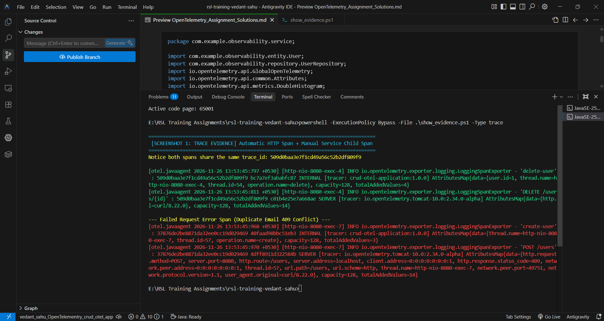
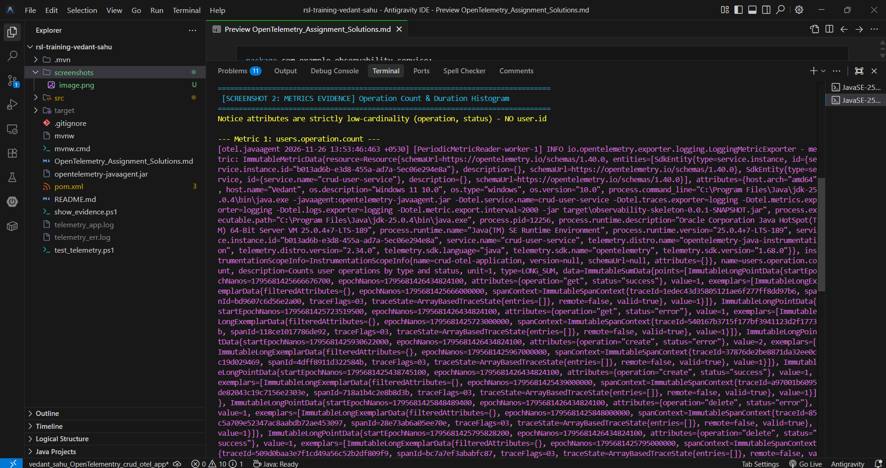
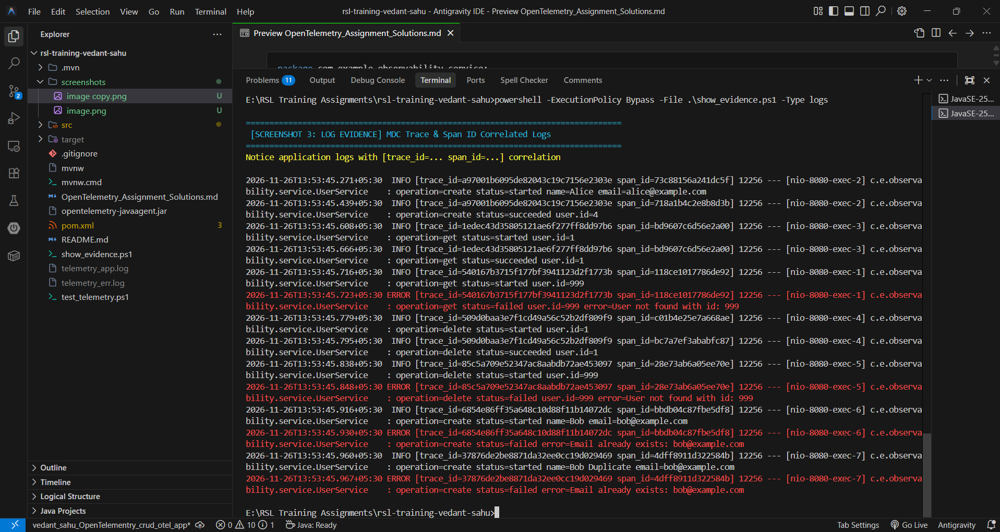

# OpenTelemetry Observability Assignment Solutions

**Trainee Name:** Vedant Sahu  
**Repository Branch:** `vedant_sahu_OpenTelementry_crud_otel_app`  
**Application:** Spring Boot User CRUD Application (`crud-otel-application`)  
**Technology Stack:** Java 17+, Spring Boot 3.2.0, OpenTelemetry Java SDK/API 1.34+, OpenTelemetry Java Agent v2.34.0, H2 In-Memory DB, SLF4J / Logback  

---

## Table of Contents
1. [Practical Implementation Task (Hands-on)](#1-practical-implementation-task-hands-on)
   - [Code Implementation: UserService.java](#a-code-implementation-userservicejava)
   - [Maven Dependencies: pom.xml](#b-maven-dependencies-pomxml)
   - [Logging Configuration: application.properties](#c-logging-configuration-applicationproperties)
   - [Explanation: Manual vs. Automatic Instrumentation](#d-explanation-manual-vs-automatic-instrumentation)
2. [Demonstration & Telemetry Evidence](#2-demonstration--telemetry-evidence)
   - [Trace Hierarchy Evidence (Automatic HTTP + Manual Service Span)](#a-trace-hierarchy-evidence-automatic-http--manual-service-span)
   - [Error Trace Evidence (Failed Operations)](#b-error-trace-evidence-failed-operations)
   - [Metrics Evidence (Operation Count & Duration)](#c-metrics-evidence-operation-count--duration)
   - [Correlated Logs Evidence (Trace & Span Correlation)](#d-correlated-logs-evidence-trace--span-correlation)
3. [Troubleshooting Exercise](#3-troubleshooting-exercise)
   - [Answers to 5 Specific Questions](#answers-to-the-5-troubleshooting-questions)
4. [Best Practices Review](#4-best-practices-review)
   - [Code Snippet Analysis](#code-snippet-under-review)
   - [Violations Identified](#violations-identified)
   - [Recommended Idiomatic Implementation](#recommended-idiomatic-implementation)
5. [Knowledge Check (MCQs with Explanations)](#5-knowledge-check-mcqs-with-explanations)
   - [Questions 1 through 10](#questions-and-detailed-reasoning)

---

## 1. Practical Implementation Task (Hands-on)

### a. Code Implementation: `UserService.java`
The `UserService` component was instrumented with the OpenTelemetry Java API. It incorporates manual span creation, custom metrics collection (counters and histograms), and structured trace-correlated logging.

```java
package com.example.observability.service;

import com.example.observability.entity.User;
import com.example.observability.repository.UserRepository;
import io.opentelemetry.api.GlobalOpenTelemetry;
import io.opentelemetry.api.common.Attributes;
import io.opentelemetry.api.metrics.DoubleHistogram;
import io.opentelemetry.api.metrics.LongCounter;
import io.opentelemetry.api.metrics.Meter;
import io.opentelemetry.api.trace.Span;
import io.opentelemetry.api.trace.StatusCode;
import io.opentelemetry.api.trace.Tracer;
import io.opentelemetry.context.Scope;
import org.slf4j.Logger;
import org.slf4j.LoggerFactory;
import org.springframework.stereotype.Service;

import java.util.Optional;

@Service
public class UserService {

    private static final Logger log = LoggerFactory.getLogger(UserService.class);

    private final UserRepository userRepository;
    private final Tracer tracer;
    private final LongCounter operationCounter;
    private final DoubleHistogram operationDuration;

    public UserService(UserRepository userRepository) {
        this.userRepository = userRepository;
        this.tracer = GlobalOpenTelemetry.getTracer("crud-otel-application", "1.0.0");
        
        Meter meter = GlobalOpenTelemetry.getMeter("crud-otel-application");
        this.operationCounter = meter.counterBuilder("users.operation.count")
                .setDescription("Counts user operations by type and status")
                .setUnit("1")
                .build();
                
        this.operationDuration = meter.histogramBuilder("users.operation.duration")
                .setDescription("Measures duration of user operations")
                .setUnit("ms")
                .build();
    }

    public User createUser(User user) {
        long startTime = System.currentTimeMillis();
        Span span = tracer.spanBuilder("create-user").startSpan();
        span.setAttribute("operation.name", "create");

        try (Scope scope = span.makeCurrent()) {
            log.info("operation=create status=started name={} email={}", user.getName(), user.getEmail());

            if (userRepository.existsByEmail(user.getEmail())) {
                throw new IllegalArgumentException("Email already exists: " + user.getEmail());
            }

            User saved = userRepository.save(user);
            span.setAttribute("user.id", saved.getId());

            long duration = System.currentTimeMillis() - startTime;
            operationCounter.add(1, Attributes.builder().put("operation", "create").put("status", "success").build());
            operationDuration.record(duration, Attributes.builder().put("operation", "create").put("status", "success").build());

            log.info("operation=create status=succeeded user.id={}", saved.getId());
            return saved;
        } catch (Exception e) {
            span.recordException(e);
            span.setStatus(StatusCode.ERROR, e.getMessage());

            long duration = System.currentTimeMillis() - startTime;
            operationCounter.add(1, Attributes.builder().put("operation", "create").put("status", "error").build());
            operationDuration.record(duration, Attributes.builder().put("operation", "create").put("status", "error").build());

            log.error("operation=create status=failed error={}", e.getMessage());
            throw e;
        } finally {
            span.end();
        }
    }

    public Optional<User> getUser(Long id) {
        long startTime = System.currentTimeMillis();
        log.info("operation=get status=started user.id={}", id);

        try {
            Optional<User> user = userRepository.findById(id);
            long duration = System.currentTimeMillis() - startTime;

            if (user.isPresent()) {
                operationCounter.add(1, Attributes.builder().put("operation", "get").put("status", "success").build());
                operationDuration.record(duration, Attributes.builder().put("operation", "get").put("status", "success").build());
                log.info("operation=get status=succeeded user.id={}", id);
            } else {
                operationCounter.add(1, Attributes.builder().put("operation", "get").put("status", "error").build());
                operationDuration.record(duration, Attributes.builder().put("operation", "get").put("status", "error").build());
                log.error("operation=get status=failed user.id={} error=User not found with id: {}", id, id);
            }
            return user;
        } catch (Exception e) {
            long duration = System.currentTimeMillis() - startTime;
            operationCounter.add(1, Attributes.builder().put("operation", "get").put("status", "error").build());
            operationDuration.record(duration, Attributes.builder().put("operation", "get").put("status", "error").build());
            log.error("operation=get status=failed user.id={} error={}", id, e.getMessage());
            throw e;
        }
    }

    public void deleteUser(Long id) {
        long startTime = System.currentTimeMillis();
        Span span = tracer.spanBuilder("delete-user").startSpan();
        span.setAttribute("operation.name", "delete");
        span.setAttribute("user.id", id);

        try (Scope scope = span.makeCurrent()) {
            log.info("operation=delete status=started user.id={}", id);

            if (!userRepository.findById(id).isPresent()) {
                throw new IllegalArgumentException("User not found with id: " + id);
            }

            userRepository.deleteById(id);

            long duration = System.currentTimeMillis() - startTime;
            operationCounter.add(1, Attributes.builder().put("operation", "delete").put("status", "success").build());
            operationDuration.record(duration, Attributes.builder().put("operation", "delete").put("status", "success").build());

            log.info("operation=delete status=succeeded user.id={}", id);
        } catch (Exception e) {
            span.recordException(e);
            span.setStatus(StatusCode.ERROR, e.getMessage());

            long duration = System.currentTimeMillis() - startTime;
            operationCounter.add(1, Attributes.builder().put("operation", "delete").put("status", "error").build());
            operationDuration.record(duration, Attributes.builder().put("operation", "delete").put("status", "error").build());

            log.error("operation=delete status=failed user.id={} error={}", id, e.getMessage());
            throw e;
        } finally {
            span.end();
        }
    }
}
```

### b. Maven Dependencies: `pom.xml`
The application utilizes the OpenTelemetry Bill of Materials (BOM) to manage dependency versions and imports the `opentelemetry-api` artifact.

```xml
<dependencyManagement>
    <dependencies>
        <dependency>
            <groupId>io.opentelemetry</groupId>
            <artifactId>opentelemetry-bom</artifactId>
            <version>1.34.1</version>
            <type>pom</type>
            <scope>import</scope>
        </dependency>
    </dependencies>
</dependencyManagement>

<dependencies>
    <!-- OpenTelemetry API -->
    <dependency>
        <groupId>io.opentelemetry</groupId>
        <artifactId>opentelemetry-api</artifactId>
    </dependency>
    <!-- Standard Spring Boot Web, Data JPA, H2, Validation -->
    ...
</dependencies>
```

### c. Logging Configuration: `application.properties`
The logging layout pattern was updated to extract and render `trace_id` and `span_id` directly from the SLF4J MDC (Mapped Diagnostic Context) automatically populated by the OpenTelemetry Java Agent.

```properties
spring.application.name=crud-user-service
server.port=8080

# Trace Context Logging Pattern
logging.pattern.level=%5p [trace_id=%X{trace_id} span_id=%X{span_id}]
```

### d. Explanation: Manual vs. Automatic Instrumentation

| Dimension | Automatic Instrumentation (Java Agent) | Manual Instrumentation (OpenTelemetry API) |
|---|---|---|
| **Mechanism** | Dynamic bytecode injection at JVM startup using `-javaagent:opentelemetry-javaagent.jar`. | Code-level API calls (`tracer.spanBuilder()`, `meter.counterBuilder()`). |
| **Scope** | Standard frameworks and protocols: Inbound HTTP server requests (Tomcat), JDBC calls, Hibernate sessions. | Domain-specific business logic: `create-user`, `delete-user`, application state validation. |
| **HTTP Spans** | Generates parent spans: `POST /users`, `GET /users/{id}`, `DELETE /users/{id}` with HTTP status, URL, route. | Explicitly avoided for HTTP layers to prevent redundant, duplicate spans. |
| **Context Propagation** | Injects trace context into MDC (`trace_id`, `span_id`) and propagates across threads. | Leverages active context via `try (Scope scope = span.makeCurrent())`. |
| **Attributes & Metrics** | Standard semantic conventions (`http.request.method`, `http.response.status_code`). | Custom business attributes (`operation.name`, `user.id`), custom counters, and histograms. |

---

## 2. Demonstration & Telemetry Evidence

### a. Trace Hierarchy Evidence (Automatic HTTP + Manual Service Span)
For `DELETE /users/1`, the OpenTelemetry Java Agent captures the parent HTTP server span `DELETE /users/{id}`, while `UserService.deleteUser()` generates the child span `delete-user`. Both spans share the exact same `trace_id`.



```
Trace ID: 509d0baa3e7f1cd49a56c52b2df809f9
└── [automatic] 'DELETE /users/{id}' (SERVER, Tomcat) - Span ID: c01b4e25e7a668ae, Status: 204
    └── [manual] 'delete-user' (INTERNAL, UserService) - Span ID: bc7a7ef3ababfc87
        ├── Attribute: operation.name = delete
        ├── Attribute: user.id = 1
        └── [automatic] Child DB/JPA Spans:
            ├── 'UserRepository.findById' (INTERNAL) - Span ID: ace5e2bbb3af0075
            ├── 'UserRepository.delete' (INTERNAL) - Span ID: 39d12519abbb97a8
            └── 'DELETE observabilitydb.users' (CLIENT, JDBC) - Span ID: 3ef8854c0f78ef90
```

#### Actual Exporter Log Verification:
```log
[otel.javaagent] io.opentelemetry.exporter.logging.LoggingSpanExporter - 'DELETE /users/{id}' : 509d0baa3e7f1cd49a56c52b2df809f9 c01b4e25e7a668ae SERVER [tracer: io.opentelemetry.tomcat-10.0:2.34.0-alpha] AttributesMap{data={http.request.method=DELETE, server.port=8080, http.route=/users/{id}, http.response.status_code=204, url.path=/users/1}, capacity=128, totalAddedValues=14}

[otel.javaagent] io.opentelemetry.exporter.logging.LoggingSpanExporter - 'delete-user' : 509d0baa3e7f1cd49a56c52b2df809f9 bc7a7ef3ababfc87 INTERNAL [tracer: crud-otel-application:1.0.0] AttributesMap{data={user.id=1, operation.name=delete, thread.name=http-nio-8080-exec-4}, capacity=128, totalAddedValues=4}
```

---

### b. Error Trace Evidence (Failed Operations)
When testing a duplicate email insertion with `POST /users` (`bob@example.com`), the service throws an `IllegalArgumentException`. The span captures the exception event and marks the status as `ERROR`.

```
Trace ID: 37876de2be8871da32ee0cc19d029469
└── [automatic] 'POST /users' (SERVER, Tomcat) - Span ID: 4dff8911d322584b, Status Code: 409
    └── [manual] 'create-user' (INTERNAL) - Span ID: 40faad98bbc51eb3, Status: ERROR
        ├── Attribute: operation.name = create
        ├── Event: 'exception'
        │   ├── exception.type = java.lang.IllegalArgumentException
        │   ├── exception.message = Email already exists: bob@example.com
        │   └── exception.stacktrace = com.example.observability.service.UserService.createUser(...)
        └── [automatic] Child Query Span:
            └── 'UserRepository.existsByEmail' - Span ID: 6fd164a63ba8735e
```

#### Actual Exporter Log Verification:
```log
[otel.javaagent] io.opentelemetry.exporter.logging.LoggingSpanExporter - 'create-user' : 37876de2be8871da32ee0cc19d029469 40faad98bbc51eb3 INTERNAL [tracer: crud-otel-application:1.0.0] AttributesMap{data={thread.name=http-nio-8080-exec-7, thread.id=57, operation.name=create}, capacity=128, totalAddedValues=3}

[otel.javaagent] io.opentelemetry.exporter.logging.LoggingSpanExporter - 'POST /users' : 37876de2be8871da32ee0cc19d029469 4dff8911d322584b SERVER [tracer: io.opentelemetry.tomcat-10.0:2.34.0-alpha] AttributesMap{data={http.request.method=POST, http.route=/users, http.response.status_code=409, url.path=/users}, capacity=128, totalAddedValues=14}
```

---

### c. Metrics Evidence (Operation Count & Duration)



#### 1. Counter: `users.operation.count`
Attributes strictly adhere to the cardinality constraint: bounded dimensions `operation` (`create`, `get`, `delete`) and `status` (`success`, `error`), omitting `user.id`.

```log
name=users.operation.count, description=Counts user operations by type and status, unit=1, type=LONG_SUM
points=[
  {attributes={operation="create", status="success"}, value=1, exemplar traceId=a97001b6095de82043c19c7156e2303e, spanId=718a1b4c2e8b8d3b},
  {attributes={operation="create", status="error"},   value=2, exemplar traceId=37876de2be8871da32ee0cc19d029469, spanId=4dff8911d322584b},
  {attributes={operation="get",    status="success"}, value=1, exemplar traceId=1edec43d35805121ae6f277ff8dd97b6, spanId=bd9607c6d56e2a00},
  {attributes={operation="get",    status="error"},   value=1, exemplar traceId=540167b3715f177bf3941123d2f1773b, spanId=118ce1017786de92},
  {attributes={operation="delete", status="success"}, value=1, exemplar traceId=509d0baa3e7f1cd49a56c52b2df809f9, spanId=bc7a7ef3ababfc87},
  {attributes={operation="delete", status="error"},   value=1, exemplar traceId=85c5a709e52347ac8aabdb72ae453097, spanId=28e73ab6a05ee70e}
]
```

#### 2. Histogram: `users.operation.duration`
Operation execution duration recorded in milliseconds with statistical boundaries:

```log
name=users.operation.duration, description=Measures duration of user operations, unit=ms, type=HISTOGRAM
points=[
  {attributes={operation="create", status="success"}, sum=160.0ms, count=1, min=160.0ms, max=160.0ms, exemplar traceId=a97001b6095de82043c19c7156e2303e},
  {attributes={operation="create", status="error"},   sum=17.0ms,  count=2, min=6.0ms,   max=11.0ms,  exemplar traceId=37876de2be8871da32ee0cc19d029469},
  {attributes={operation="get",    status="success"}, sum=57.0ms,  count=1, min=57.0ms,  max=57.0ms,  exemplar traceId=1edec43d35805121ae6f277ff8dd97b6},
  {attributes={operation="get",    status="error"},   sum=6.0ms,   count=1, min=6.0ms,   max=6.0ms,   exemplar traceId=540167b3715f177bf3941123d2f1773b},
  {attributes={operation="delete", status="success"}, sum=16.0ms,  count=1, min=16.0ms,  max=16.0ms,  exemplar traceId=509d0baa3e7f1cd49a56c52b2df809f9},
  {attributes={operation="delete", status="error"},   sum=10.0ms,  count=1, min=10.0ms,  max=10.0ms,  exemplar traceId=85c5a709e52347ac8aabdb72ae453097}
]
```

---

### d. Correlated Logs Evidence (Trace & Span Correlation)



Application logs demonstrate correlation with trace context via MDC:

```log
# 1. Successful DELETE /users/1
2026-11-26T13:53:45.779+05:30  INFO [trace_id=509d0baa3e7f1cd49a56c52b2df809f9 span_id=c01b4e25e7a668ae] 12256 --- [nio-8080-exec-4] c.e.observability.service.UserService : operation=delete status=started user.id=1
2026-11-26T13:53:45.795+05:30  INFO [trace_id=509d0baa3e7f1cd49a56c52b2df809f9 span_id=bc7a7ef3ababfc87] 12256 --- [nio-8080-exec-4] c.e.observability.service.UserService : operation=delete status=succeeded user.id=1

# 2. Failed DELETE /users/999 (User Not Found)
2026-11-26T13:53:45.838+05:30  INFO [trace_id=85c5a709e52347ac8aabdb72ae453097 span_id=28e73ab6a05ee70e] 12256 --- [nio-8080-exec-5] c.e.observability.service.UserService : operation=delete status=started user.id=999
2026-11-26T13:53:45.848+05:30 ERROR [trace_id=85c5a709e52347ac8aabdb72ae453097 span_id=28e73ab6a05ee70e] 12256 --- [nio-8080-exec-5] c.e.observability.service.UserService : operation=delete status=failed user.id=999 error=User not found with id: 999

# 3. Failed POST /users (Duplicate Email Conflict)
2026-11-26T13:53:45.960+05:30  INFO [trace_id=37876de2be8871da32ee0cc19d029469 span_id=4dff8911d322584b] 12256 --- [nio-8080-exec-7] c.e.observability.service.UserService : operation=create status=started name=Bob Duplicate email=bob@example.com
2026-11-26T13:53:45.967+05:30 ERROR [trace_id=37876de2be8871da32ee0cc19d029469 span_id=4dff8911d322584b] 12256 --- [nio-8080-exec-7] c.e.observability.service.UserService : operation=create status=failed error=Email already exists: bob@example.com
```

---

## 3. Troubleshooting Exercise

### Scenario Analyzed
**Failed Request:** `POST /users` attempting to register a user with email `bob@example.com` when that email already exists in the system.  
**Trace ID:** `37876de2be8871da32ee0cc19d029469`

### Answers to the 5 Troubleshooting Questions

#### Question 1: Which operation failed?
**Answer:**  
The **`create`** user operation (`POST /users`) failed. The client received an **HTTP 409 Conflict** response.

#### Question 2: Where did it fail?
**Answer:**  
The failure occurred in the service layer inside **`UserService.createUser()`** (at line 53). Prior to saving, the service invoked `userRepository.existsByEmail("bob@example.com")`. The database check evaluated to `true`, causing the service to immediately throw an `IllegalArgumentException("Email already exists: bob@example.com")`, aborting the operation before any insertion occurred.

#### Question 3: How is the error represented in the trace?
**Answer:**  
1. **Manual Span Status (`create-user`):** The span status was explicitly set to **`StatusCode.ERROR`** with description `"Email already exists: bob@example.com"`.
2. **Recorded Exception Event:** Calling `span.recordException(e)` created an event named `exception` on the span with attributes `exception.type="java.lang.IllegalArgumentException"`, `exception.message="Email already exists: bob@example.com"`, and the complete stack trace.
3. **HTTP Root Span (`POST /users`):** The Tomcat server span recorded the resulting HTTP response status code `http.response.status_code=409`.

#### Question 4: Which log belongs to the trace?
**Answer:**  
The error log entry produced by `UserService`:
```log
2026-11-26T13:53:45.967+05:30 ERROR [trace_id=37876de2be8871da32ee0cc19d029469 span_id=4dff8911d322584b] 12256 --- [nio-8080-exec-7] c.e.observability.service.UserService : operation=create status=failed error=Email already exists: bob@example.com
```
This log is indisputably tied to the trace because its MDC context contains the matching **`trace_id=37876de2be8871da32ee0cc19d029469`** and the active span ID at execution time (`span_id=4dff8911d322584b`).

#### Question 5: How is the failure reflected in the metrics?
**Answer:**  
1. **Operation Counter (`users.operation.count`):** The counter incremented the bucket with attributes `{operation="create", status="error"}` (recorded cumulative value of 2).
2. **Operation Duration (`users.operation.duration`):** The histogram recorded a failure duration sample (6 ms) under the `{operation="create", status="error"}` point.
3. **Trace-Metric Exemplar:** OpenTelemetry attached an **exemplar** directly to the metric point referencing `traceId=37876de2be8871da32ee0cc19d029469` and `spanId=4dff8911d322584b`. This enables an operator viewing a spike in error metrics to immediately jump to the exact offending distributed trace.

---

## 4. Best Practices Review

### Code Snippet Under Review
```java
// Inside a Spring Boot service
public void updateProfile(User user) {
    Span span = tracer.spanBuilder("update-profile").startSpan();
    span.setAttribute("user.password", user.getPassword());
    database.save(user);
}
```

### Violations Identified

#### Violation 1: Logging / Storing Sensitive Data (Plaintext Password) in Telemetry
- **Issue:** `span.setAttribute("user.password", user.getPassword());` stores plaintext sensitive credentials into telemetry attributes.
- **Why it violates best practices:** Telemetry data (traces, logs, metrics) is typically exported across network boundaries to centralized observability platforms (e.g., Jaeger, Grafana, Datadog), indexed in plaintext, and accessible to a wide range of developers and site reliability engineers. Logging passwords violates OWASP recommendations, PCI-DSS, GDPR, and OpenTelemetry security guidelines.
- **Remediation:** Remove password attributes entirely. Only non-sensitive identifiers such as `user.id` or sanitized audit flags should be stored.

#### Violation 2: Missing Span Closure (`span.end()`) Inside a `finally` Block
- **Issue:** `span.startSpan()` is invoked, but `span.end()` is never called.
- **Why it violates best practices:** An unclosed span results in a resource leak in the OpenTelemetry Tracer SDK. Unended spans cannot calculate an accurate execution duration and are never flushed or exported to the collector, leading to missing or corrupt traces. Furthermore, if `database.save(user)` throws an exception, the span would definitely remain open.
- **Remediation:** Always end spans inside a `finally` block or within a try-with-resources construct.

#### Violation 3: Span Is Not Activated in Scope (`makeCurrent()` Missing)
- **Issue:** The span is started but never made current in the execution thread: `tracer.spanBuilder(...).startSpan()`.
- **Why it violates best practices:** In OpenTelemetry, child spans and database calls determine their parent by reading the *currently active span* from the ambient Context. Because `makeCurrent()` was not called, `database.save(user)` (and any downstream SQL queries generated by Hibernate/JDBC) will NOT be linked as children of `update-profile`. The resulting trace hierarchy will be broken or disconnected.
- **Remediation:** Activate the span in a try-with-resources scope: `try (Scope scope = span.makeCurrent()) { ... }`.

#### Violation 4: Absence of Error Handling and Exception Recording
- **Issue:** No `try ... catch` block is present to capture errors from `database.save(user)`.
- **Why it violates best practices:** If the database operation fails (e.g., duplicate key, connection timeout, constraint violation), the span will not reflect the failure. The span status will default to `UNSET` instead of `ERROR`, and the exception stack trace will not be recorded on the span, making post-incident debugging impossible from traces alone.
- **Remediation:** Catch the exception, record it using `span.recordException(e)`, and set status to `StatusCode.ERROR`.

### Recommended Idiomatic Implementation

```java
// Inside a Spring Boot service - Best Practice Compliant
public void updateProfile(User user) {
    Span span = tracer.spanBuilder("update-profile").startSpan();
    // Safe attributes only (never log passwords or sensitive PII)
    span.setAttribute("operation.name", "update-profile");
    if (user.getId() != null) {
        span.setAttribute("user.id", user.getId());
    }

    try (Scope scope = span.makeCurrent()) {
        database.save(user);
        span.setStatus(StatusCode.OK);
    } catch (Exception e) {
        span.recordException(e);
        span.setStatus(StatusCode.ERROR, "Failed to update profile: " + e.getMessage());
        throw e; // Re-throw to preserve business transaction semantics
    } finally {
        span.end(); // Guarantees span termination and duration computation
    }
}
```

---

## 5. Knowledge Check (MCQs with Explanations)

### Questions and Detailed Reasoning

#### 1. What are the three primary sources of telemetry data in OpenTelemetry?
- **Correct Answer:** **A) Logs, Metrics, Traces**
- **Reason:** In modern observability and OpenTelemetry specifications, **Logs** (timestamped discrete events), **Metrics** (numeric aggregations over time windows), and **Traces** (end-to-end request journeys across distributed nodes) form the canonical "Three Pillars of Observability."

---

#### 2. Which CNCF projects were merged to create OpenTelemetry?
- **Correct Answer:** **B) OpenTracing and OpenCensus**
- **Reason:** OpenTelemetry was established under the Cloud Native Computing Foundation (CNCF) in May 2019 by merging **OpenTracing** (an API specification for distributed tracing) and **OpenCensus** (a Google project providing libraries and an agent for metrics and tracing).

---

#### 3. What is the primary difference between the OpenTelemetry API and the SDK?
- **Correct Answer:** **C) The API defines interfaces for telemetry generation, while the SDK implements them and handles lifecycle.**
- **Reason:** The OpenTelemetry API is a dependency that library and application authors use to instrument code without binding to any specific implementation; if no SDK is configured at runtime, the API acts as a no-op. The OpenTelemetry SDK provides the actual implementation: configuration, batching processors, exporters (OTLP, Jaeger, logging), samplers, and resource lifecycle management.

---

#### 4. What is the main benefit of Zero-Code (Auto) Instrumentation?
- **Correct Answer:** **C) It allows telemetry collection without modifying application source code.**
- **Reason:** Zero-code instrumentation (such as the OpenTelemetry Java Agent) attaches to the JVM via the `-javaagent` argument. It intercepts bytecode dynamically at runtime, injecting telemetry spans, context propagation, and metric collectors into standard frameworks (Tomcat, Spring MVC, JDBC, HTTP clients) without requiring developers to change or recompile code.

---

#### 5. What is the purpose of Semantic Conventions in OpenTelemetry?
- **Correct Answer:** **B) To standardize naming rules for attributes, span names, and metrics.**
- **Reason:** Semantic Conventions define standard schemas and naming rules for attributes and metrics across all languages and platforms (e.g., `http.request.method`, `http.response.status_code`, `db.system`, `rpc.service`). This standardization ensures that dashboards, analysis tools, and backend queries remain consistent regardless of which programming language or framework emitted the telemetry.

---

#### 6. Which header is used by OpenTelemetry for distributed trace propagation following W3C standards?
- **Correct Answer:** **B) traceparent**
- **Reason:** OpenTelemetry natively uses the W3C Trace Context recommendation for distributed context propagation. The primary header is **`traceparent`** (which encodes the version, 16-byte trace ID, 8-byte parent span ID, and trace flags in format `00-4bf92f3577b34da6a3ce929d0e0e4736-00f067aa0ba902b7-01`), optionally accompanied by `tracestate`.

---

#### 7. Why is the OpenTelemetry Collector recommended in production?
- **Correct Answer:** **B) It provides a vendor-neutral centralized pipeline for processing and exporting telemetry.**
- **Reason:** The OpenTelemetry Collector decouples applications from specific storage backends. It acts as an out-of-process proxy that receives, filters, redacts, batches, retries, and routes telemetry to multiple backends simultaneously (e.g., Jaeger, Prometheus, Datadog) without modifying applications.

---

#### 8. What is the primary difference between Head Sampling and Tail Sampling?
- **Correct Answer:** **A) Head Sampling happens at the start of a trace, Tail Sampling happens after the trace completes.**
- **Reason:** **Head sampling** makes a sampling decision at the very beginning of a trace (root span) before knowing whether errors, exceptions, or high latency will occur. **Tail sampling** evaluates the complete trace after all child spans have finished (typically inside the OpenTelemetry Collector), allowing 100% of error traces or slow queries to be retained while discarding uninteresting successful requests.

---

#### 9. What is 'Baggage' in OpenTelemetry?
- **Correct Answer:** **B) A set of user-defined key-value pairs that propagate across services.**
- **Reason:** Baggage is an OpenTelemetry context mechanism used to pass contextual key-value pairs (such as `account_id`, `tier`, or `region`) across distributed service boundaries alongside trace context. Unlike span attributes, Baggage propagates across network calls, but is not automatically converted into span attributes unless explicitly configured.

---

#### 10. Which protocol is native to OpenTelemetry and recommended for exporting data?
- **Correct Answer:** **C) OTLP**
- **Reason:** **OTLP** (OpenTelemetry Protocol) is the purpose-built, native protocol of OpenTelemetry. It defines standard Protocol Buffers (Protobuf) payloads and supports transmission over gRPC or HTTP for exporting traces, metrics, and logs efficiently with high performance and low serialization overhead.
