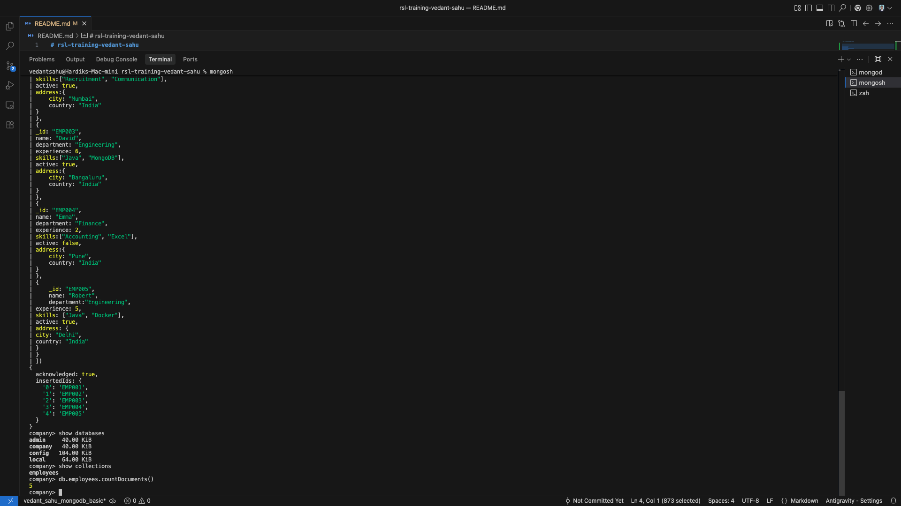
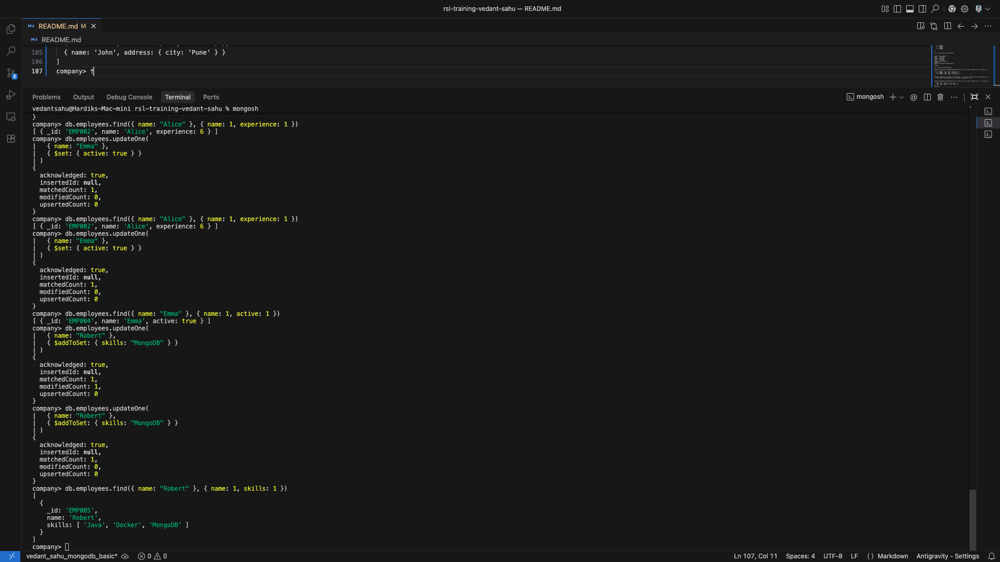
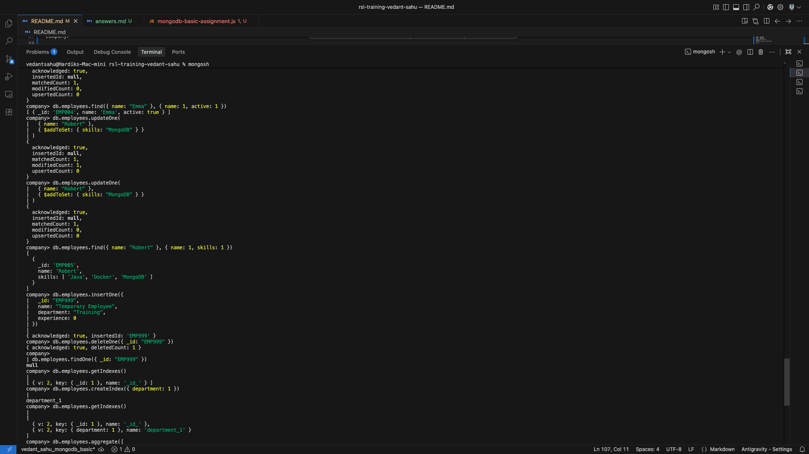
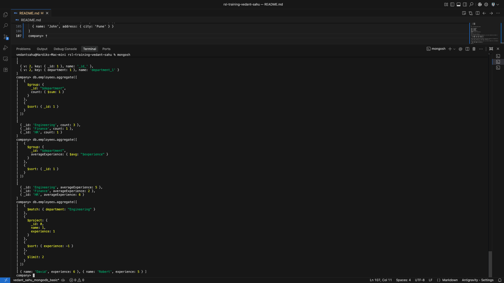

# MongoDB Basic Assignment: Company Employees Database

## Overview
This repository contains the MongoDB solution script, documentation, and query outputs for the **MongoDB Basic Assignment**. The assignment demonstrates core MongoDB concepts and operations using `mongosh`:
- **Databases & Collections Setup**
- **CRUD Operations (Create, Read, Update, Delete)**
- **Query Operators** (`$gte`, `$in`, dot notation for nested documents)
- **Projection, Sorting & Limiting** (`sort()`, `limit()`)
- **Update Operators** (`$inc`, `$set`, `$addToSet`)
- **Indexing & Verification** (`createIndex()`, `getIndexes()`)
- **Aggregation Framework** (`$match`, `$group`, `$project`, `$sort`, `$limit`)
- **MongoDB Fundamentals & Best Practices**

---

## Deliverables
- [`mongodb-basic-assignment.js`](./mongodb-basic-assignment.js) - Complete MongoDB commands and queries for Tasks 1–6.
- [`answers.md`](./answers.md) - Answers to the 10 Multiple Choice Questions (Task 7).
- `screenshots/` - Screenshots validating the execution of connection, queries, updates, indexing, and aggregations.

---

## Dataset Schema

### Database: `company`
### Collection: `employees`

| Field | Type | Description |
| :--- | :--- | :--- |
| `_id` | String | Unique employee identifier (e.g., `"EMP001"`) |
| `name` | String | Employee full name |
| `department` | String | Department name (`Engineering`, `HR`, `Finance`) |
| `experience` | Number | Years of experience |
| `skills` | Array of Strings | Technical and professional skills |
| `active` | Boolean | Employment status (`true` / `false`) |
| `address` | Object (Embedded) | Nested document containing `city` and `country` |

---

## Tasks & Solution Queries

### Task 1: Local Setup and Data Creation

#### Step 1: Verify Connection & Select Database
```javascript
use company;
```

#### Step 2: Insert Initial Dataset
```javascript
db.employees.insertMany([
  {
    _id: "EMP001",
    name: "John",
    department: "Engineering",
    experience: 4,
    skills: ["Java", "Spring Boot"],
    active: true,
    address: {
      city: "Pune",
      country: "India"
    }
  },
  {
    _id: "EMP002",
    name: "Alice",
    department: "HR",
    experience: 3,
    skills: ["Recruitment", "Communication"],
    active: true,
    address: {
      city: "Mumbai",
      country: "India"
    }
  },
  {
    _id: "EMP003",
    name: "David",
    department: "Engineering",
    experience: 6,
    skills: ["Java", "MongoDB"],
    active: true,
    address: {
      city: "Bengaluru",
      country: "India"
    }
  },
  {
    _id: "EMP004",
    name: "Emma",
    department: "Finance",
    experience: 2,
    skills: ["Accounting", "Excel"],
    active: false,
    address: {
      city: "Pune",
      country: "India"
    }
  },
  {
    _id: "EMP005",
    name: "Robert",
    department: "Engineering",
    experience: 5,
    skills: ["Java", "Docker"],
    active: true,
    address: {
      city: "Delhi",
      country: "India"
    }
  }
]);
```

#### Verification
```javascript
show dbs;
show collections;
db.employees.countDocuments(); // Returns 5
```

---

### Task 2: Read and Query Operations

#### 2.1 Engineering Employees
Retrieve employees whose department is `Engineering`, returning only `_id`, `name`, and `experience`, sorted by `name` ascending:
```javascript
db.employees.find(
  { department: "Engineering" },
  { _id: 1, name: 1, experience: 1 }
).sort({ name: 1 });
```

#### 2.2 Employees with 5 or More Years of Experience
Retrieve employees with `experience >= 5`, returning `name` and `experience` (excluding `_id`), sorted by `experience` descending:
```javascript
db.employees.find(
  { experience: { $gte: 5 } },
  { _id: 0, name: 1, experience: 1 }
).sort({ experience: -1 });
```

#### 2.3 Nested Document Query
Retrieve employees living in Pune, returning `name` and `city` sorted by `name`:
```javascript
db.employees.find(
  { "address.city": "Pune" },
  { _id: 0, name: 1, "address.city": 1 }
).sort({ name: 1 });
```

#### 2.4 Array Query
Retrieve employees whose skills contain either `MongoDB` or `Spring Boot`, sorted by `name` ascending:
```javascript
db.employees.find(
  { skills: { $in: ["MongoDB", "Spring Boot"] } }
).sort({ name: 1 });
```

#### 2.5 Sorting and Limiting
Retrieve top 2 employees with the highest experience:
```javascript
db.employees.find(
  {},
  { _id: 0, name: 1, experience: 1 }
).sort({ experience: -1 }).limit(2);
```

---

### Task 3: Update Operations

#### 3.1 `$inc` - Increment Experience
Increase Alice's experience by 1:
```javascript
db.employees.updateOne(
  { name: "Alice" },
  { $inc: { experience: 1 } }
);
```

#### 3.2 `$set` - Update Field Value
Change Emma's active status from `false` to `true`:
```javascript
db.employees.updateOne(
  { name: "Emma" },
  { $set: { active: true } }
);
```

#### 3.3 `$addToSet` - Add Unique Element to Array
Add `MongoDB` to Robert's skills array without duplication:
```javascript
db.employees.updateOne(
  { name: "Robert" },
  { $addToSet: { skills: "MongoDB" } }
);
```

---

### Task 4: Delete Operation

#### Insert and Delete Temporary Document
```javascript
// 1. Insert temporary document
db.employees.insertOne({
  _id: "EMP999",
  name: "Temporary Employee",
  department: "Training",
  experience: 0
});

// 2. Delete using deleteOne()
db.employees.deleteOne({ _id: "EMP999" });

// 3. Verify deletion
db.employees.findOne({ _id: "EMP999" }); // Returns null
```

---

### Task 5: Indexing

#### 5.1 Check Initial Indexes
```javascript
db.employees.getIndexes();
// Output contains default index: _id_
```

#### 5.2 Create Ascending Index on `department`
```javascript
db.employees.createIndex({ department: 1 });
```

#### 5.3 Verify Created Indexes
```javascript
db.employees.getIndexes();
// Output contains: _id_ and department_1
```

---

### Task 6: Aggregation

#### 6.1 Employees per Department
Count employees per department, sorted by department name:
```javascript
db.employees.aggregate([
  {
    $group: {
      _id: "$department",
      count: { $sum: 1 }
    }
  },
  {
    $sort: { _id: 1 }
  }
]);
```

#### 6.2 Average Experience per Department
Calculate average employee experience per department, sorted by department name ascending:
```javascript
db.employees.aggregate([
  {
    $group: {
      _id: "$department",
      averageExperience: { $avg: "$experience" }
    }
  },
  {
    $sort: { _id: 1 }
  }
]);
```

#### 6.3 Top 2 Engineering Employees
Retrieve top 2 Engineering employees by experience:
```javascript
db.employees.aggregate([
  {
    $match: { department: "Engineering" }
  },
  {
    $project: {
      _id: 0,
      name: 1,
      experience: 1
    }
  },
  {
    $sort: { experience: -1 }
  },
  {
    $limit: 2
  }
]);
```

---

### Task 7: Multiple Choice Questions (MCQs)
See full details and explanations in [`answers.md`](./answers.md):
- **Q1**: B
- **Q2**: C
- **Q3**: C
- **Q4**: C
- **Q5**: B
- **Q6**: C
- **Q7**: B
- **Q8**: C
- **Q9**: C
- **Q10**: B

---

## Execution Screenshots

### 1. Connection & Initial Setup
MongoDB connection, `show dbs`, and `employees` collection verification:


### 2. Query and Update Operations
Executing query operators and update operations (`$inc`, `$set`, `$addToSet`):


### 3. Index Verification
Verifying default index and newly created ascending index on `department` using `getIndexes()`:


### 4. Aggregation Pipelines
Results of aggregation queries for counts, averages, and filtered limits:
