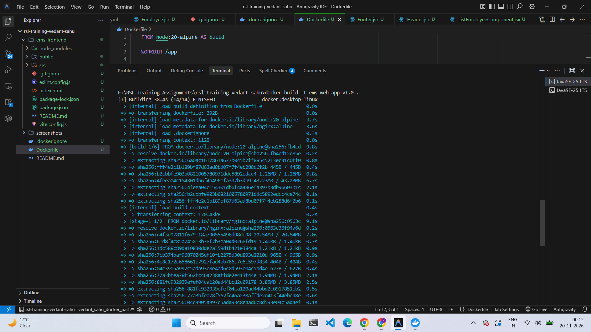
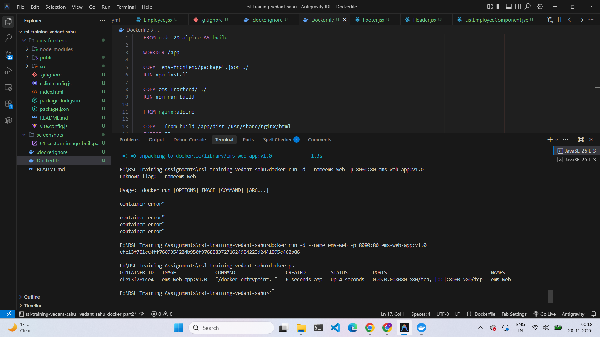
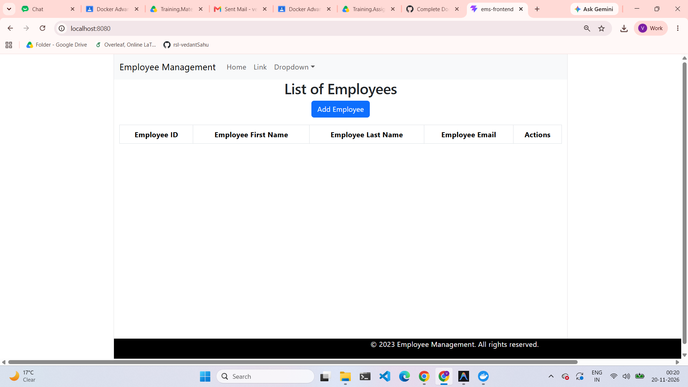
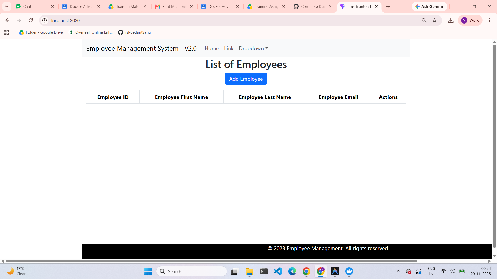
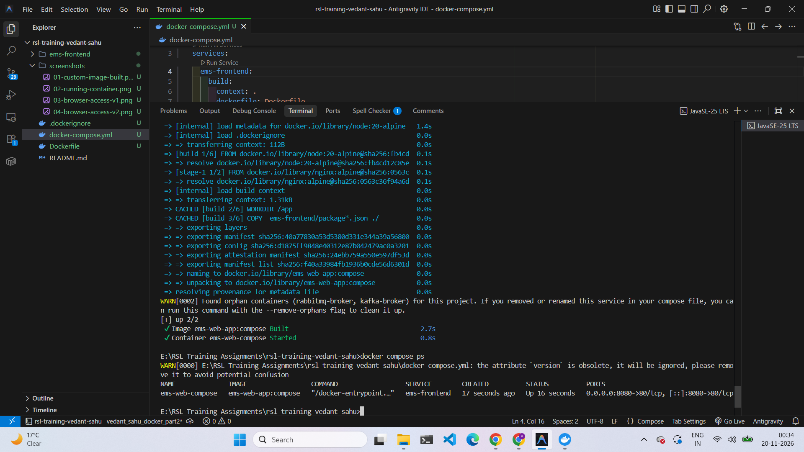

# Docker [Part 2] - Custom Web Application & Docker Compose

## Overview
This repository contains the solution, source code, container configurations, and execution proofs for **Docker [Part 2]**. Building upon Part 1 (which used a pre-built Nginx image), this assignment focuses on containerizing a custom frontend web application (**Employee Management System (EMS)** built with React, Vite, and Bootstrap) using an optimized multi-stage `Dockerfile`, and managing its lifecycle declaratively with **Docker Compose**.

### Key Concepts Covered:
- **Custom Docker Images**: Authoring a production-ready `Dockerfile` tailored for a modern frontend single-page application.
- **Multi-Stage Builds**: Using `node:20-alpine` to compile and bundle source code, and lightweight `nginx:alpine` to serve production assets (resulting in an optimized ~26.5 MB final image).
- **Image Versioning & Updates**: Tagging releases (`v1.0` and `v2.0`), updating application components, rebuilding images, and validating live updates.
- **Docker Compose Orchestration**: Defining services, build contexts, port forwardings (`8080:80`), and environment variables in `docker-compose.yml`.
- **Compose Lifecycle Management**: Building, launching, viewing logs, stopping, restarting, and tearing down multi-container services with unified CLI commands.

---

## Deliverables Summary

### 1. Project Configuration Files
- [`Dockerfile`](./Dockerfile): Multi-stage container specification.
- [`docker-compose.yml`](./docker-compose.yml): Service definition for Docker Compose.
- [`.dockerignore`](./.dockerignore): Build context optimization rules.

### 2. Screenshots Directory
All verification screenshots are stored in the [`screenshots/`](./screenshots/) directory:
1. [`01-custom-image-built.png`](./screenshots/01-custom-image-built.png) — Custom image `ems-web-app:v1.0` built successfully via multi-stage Docker build.
2. [`02-running-container.png`](./screenshots/02-running-container.png) — Application container `ems-web` running with port mapping `8080:80`.
3. [`03-browser-access-v1.png`](./screenshots/03-browser-access-v1.png) — Initial application interface loaded in browser at `http://localhost:8080`.
4. [`04-browser-access-v2.png`](./screenshots/04-browser-access-v2.png) — Rebuilt image `ems-web-app:v2.0` reflecting component updates in browser.
5. [`05-docker-compose-service-running.png`](./screenshots/05-docker-compose-service-running.png) — Service running and verified through `docker compose up -d --build` and `docker compose ps`.

---

## Deliverables: Important Docker & Docker Compose Commands Used

| Category | Command | Description |
| :--- | :--- | :--- |
| **Docker Build** | `docker build -t ems-web-app:v1.0 .` | Build and tag custom Docker image from the multi-stage `Dockerfile`. |
| **Docker Build** | `docker build -t ems-web-app:v2.0 .` | Rebuild image under a new release tag after modifying code. |
| **Docker Run** | `docker run -d --name ems-web -p 8080:80 ems-web-app:v1.0` | Launch container in detached mode mapping host port 8080 to container port 80. |
| **Docker Status** | `docker ps` | List active containers, verify uptime, port mappings, and health. |
| **Docker Stop** | `docker stop ems-web` | Gracefully shut down the standalone container. |
| **Docker Remove** | `docker rm ems-web` | Remove the stopped standalone container. |
| **Compose Up** | `docker compose up -d --build` | Build image if needed and start all defined services in the background. |
| **Compose Status** | `docker compose ps` | View the status of services managed by Docker Compose. |
| **Compose Logs** | `docker compose logs` | Display aggregated output and access logs for services. |
| **Compose Stop** | `docker compose stop` | Pause/stop running services without deleting containers. |
| **Compose Start** | `docker compose start` | Resume stopped services. |
| **Compose Down** | `docker compose down` | Stop and remove containers, networks, and volumes created by Compose. |

---

## Detailed Task Walkthrough

### Task 1: Create a Dockerfile

A multi-stage `Dockerfile` was authored in the root of the repository to build and serve the React + Vite frontend (`ems-frontend`).

#### Multi-Stage Build Architecture:
1. **Build Stage (`node:20-alpine`)**:
   - Sets working directory to `/app`.
   - Copies `package.json` and `package-lock.json` to leverage Docker layer caching for `npm install`.
   - Copies frontend source code and compiles the production bundle via `npm run build` into `/app/dist`.
2. **Production Stage (`nginx:alpine`)**:
   - Employs a minimal Nginx image (~40 MB base).
   - Copies only the compiled static assets from `/app/dist` in the build stage to Nginx's default document root `/usr/share/nginx/html`.
   - Discards Node.js runtime, compilers, and development dependencies, reducing image size to **26.5 MB**.
   - Exposes port `80` and runs Nginx in the foreground.

```dockerfile
# Stage 1: Build the React + Vite frontend application
FROM node:20-alpine AS build

WORKDIR /app

# Copy dependency manifests and install packages
COPY ems-frontend/package*.json ./
RUN npm install

# Copy application source files and build production bundle
COPY ems-frontend/ ./
RUN npm run build

# Stage 2: Serve the static build using Nginx (extends Part 1)
FROM nginx:alpine

# Copy built production assets into Nginx web root
COPY --from=build /app/dist /usr/share/nginx/html

# Expose standard HTTP port
EXPOSE 80

# Run Nginx in foreground
CMD ["nginx", "-g", "daemon off;"]
```

---

### Task 2: Build and Run the Custom Image

#### 1. Build and tag version 1.0:
```powershell
docker build -t ems-web-app:v1.0 .
```
- All 14 build steps completed successfully.
- Image tagged as `ems-web-app:v1.0`.

#### Verification Screenshot:


#### 2. Run container in detached mode:
```powershell
docker run -d --name ems-web -p 8080:80 ems-web-app:v1.0
```
- Container ID: `efe13f781ce4...`
- Verified status via `docker ps` showing port mapping `0.0.0.0:8080->80/tcp, [::]:8080->80/tcp`.

#### Verification Screenshot:


#### 3. Browser Access (Version 1.0):
Navigated to `http://localhost:8080` in the browser. The Employee Management System UI rendered cleanly with navigation bar, table headers, and actions.

#### Verification Screenshot:


#### 4. Application Modification & Tag `v2.0` Verification:
- Modified `ems-frontend/src/components/Header.jsx` to update the application brand title to `"Employee Management System - v2.0"`.
- Rebuilt image under new tag:
  ```powershell
  docker build -t ems-web-app:v2.0 .
  ```
- Stopped and replaced old container:
  ```powershell
  docker stop ems-web
  docker rm ems-web
  docker run -d --name ems-web -p 8080:80 ems-web-app:v2.0
  ```
- Verified updated title displayed at `http://localhost:8080`.

#### Verification Screenshot:


---

### Task 3: Create a Docker Compose Configuration

To eliminate manual parameter entry and ensure reproducible configuration across environments, `docker-compose.yml` was defined:

```yaml
services:
  ems-frontend:
    build:
      context: .
      dockerfile: Dockerfile
    image: ems-web-app:compose
    container_name: ems-web-compose
    ports:
      - "8080:80"
    environment:
      - APP_ENV=production
      - VITE_APP_TITLE=EMS_Portal
    restart: always
```

#### Configuration Breakdown:
- **`services.ems-frontend`**: Defines the application service.
- **`build`**: Specifies the build context (`.`) and targets the multi-stage `Dockerfile`.
- **`image`**: Tags the generated image as `ems-web-app:compose`.
- **`container_name`**: Sets explicit container name `ems-web-compose`.
- **`ports`**: Binds host port `8080` to container port `80`.
- **`environment`**: Injects runtime configuration variables (`APP_ENV` and `VITE_APP_TITLE`).
- **`restart: always`**: Ensures automatic container recovery upon daemon restart or failure.

---

### Task 4: Run and Manage the Application Using Docker Compose

#### 1. Build and start service:
```powershell
docker compose up -d --build
```
Build output compiled the container, tagged `ems-web-app:compose`, and created container `ems-web-compose`.

#### 2. Verify running service:
```powershell
docker compose ps
```
Service `ems-frontend` verified in state `Up` with active binding `0.0.0.0:8080->80/tcp`.

#### Verification Screenshot:


#### 3. View logs:
```powershell
docker compose logs
```
Displays Nginx initialization logs and incoming HTTP request traffic.

#### 4. Stop and Restart Lifecycle:
```powershell
# Stop service
docker compose stop

# Restart service
docker compose start
```
Verified that the application resumed serving requests at `http://localhost:8080` without data loss or configuration drift.

#### 5. Clean Teardown:
```powershell
docker compose down
```
Gracefully stopped and deleted container `ems-web-compose` and associated network.
