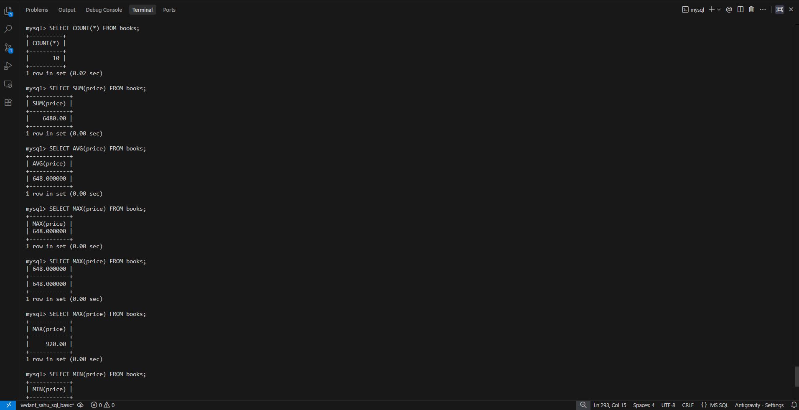
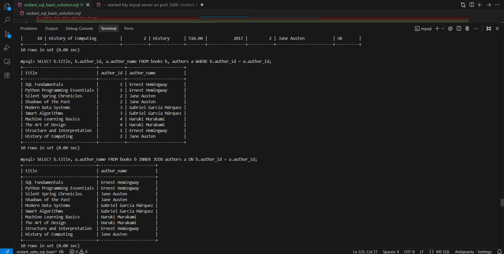
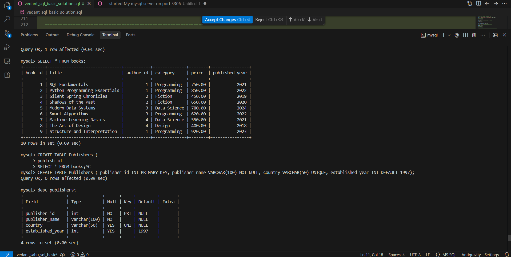

# SQL (Basic) Assignment: Online Bookstore Database

## Overview
This repository contains the database schema, sample dataset, and SQL queries for an **Online Bookstore** relational database. The implementation demonstrates core SQL fundamentals across 8 sections and 21 tasks:
- **Table Creation & Schema Design** (with Data Types & Constraints)
- **Data Insertion, Updating & Deletion (DML)**
- **Basic Queries & Aliases**
- **Data Filtering** (`WHERE`, `BETWEEN`, `LIKE`)
- **Sorting and Limiting** (`ORDER BY`, `LIMIT`)
- **Aggregate Functions** (`COUNT`, `SUM`, `AVG`, `MAX`, `MIN`)
- **Grouping & Conditions** (`GROUP BY`, `HAVING`)
- **Table Joins** (`INNER JOIN`, `LEFT JOIN`, `RIGHT JOIN`)
- **Constraints Implementation** (`PRIMARY KEY`, `NOT NULL`, `UNIQUE`, `DEFAULT`)

---

## Database Schema

The database `bookstore_db` consists of the following tables:

### 1. Authors Table
| Column Name | Data Type | Description |
| :--- | :--- | :--- |
| `author_id` | `INT` | Unique identifier for each author |
| `author_name` | `VARCHAR(100)` | Full name of the author |
| `country` | `VARCHAR(50)` | Author's country |

### 2. Books Table
| Column Name | Data Type | Description |
| :--- | :--- | :--- |
| `book_id` | `INT` | Unique identifier for each book |
| `title` | `VARCHAR(100)` | Title of the book |
| `author_id` | `INT` | Foreign identifier referencing `Authors` |
| `category` | `VARCHAR(50)` | Category/genre of the book |
| `price` | `DECIMAL(10,2)` | Book price |
| `published_year` | `INT` | Publication year |

### 3. Publishers Table (Task 21)
| Column Name | Data Type | Constraints | Description |
| :--- | :--- | :--- | :--- |
| `publisher_id` | `INT` | `PRIMARY KEY` | Primary Key identifier |
| `publisher_name` | `VARCHAR(100)` | `NOT NULL` | Publisher name (cannot be NULL) |
| `country` | `VARCHAR(50)` | `UNIQUE` | Unique country name |
| `established_year` | `INT` | `DEFAULT 1997` | Established year (defaults to 1997) |

---

## Steps to Execute the SQL Script

### Prerequisites
- MySQL Server installed and running on port 3306.
- Access to MySQL via Command Line Client or Terminal.

### Option 1: Execute via Command Line
Run the entire SQL script directly from your terminal:
```bash
mysql -u root -p < vedant_sql_basic_solution.sql
```

### Option 2: Execute within MySQL Shell
1. Log in to MySQL:
   ```bash
   mysql -u root -p
   ```
2. Run the script:
   ```sql
   SOURCE vedant_sql_basic_solution.sql;
   ```

---

## Task Execution and Output Walkthrough

### Section 1: Basic Queries

#### Task 1: Display all books.
```sql
SELECT * FROM books;
```
**Output:**
```
+---------+-------------------------------+-----------+--------------+--------+----------------+
| book_id | title                         | author_id | category     | price  | published_year |
+---------+-------------------------------+-----------+--------------+--------+----------------+
|       1 | SQL Fundamentals              |         1 | Programming  | 750.00 |           2021 |
|       2 | Python Programming Essentials |         1 | Programming  | 850.00 |           2022 |
|       3 | Silent Spring Chronicles      |         2 | Fiction      | 450.00 |           2019 |
|       4 | Shadows of the Past           |         2 | Fiction      | 650.00 |           2020 |
|       5 | Modern Data Systems           |         3 | Data Science | 780.00 |           2024 |
|       6 | Smart Algorithms              |         3 | Programming  | 620.00 |           2022 |
|       7 | Machine Learning Basics       |         4 | Data Science | 550.00 |           2021 |
|       8 | The Art of Design             |         4 | Design       | 400.00 |           2018 |
|       9 | Structure and Interpretation  |         1 | Programming  | 920.00 |           2023 |
|      10 | History of Computing          |         2 | History      | 510.00 |           2017 |
+---------+-------------------------------+-----------+--------------+--------+----------------+
10 rows in set (0.00 sec)
```

#### Task 2: Display only the book title and price.
```sql
SELECT title, price FROM books;
```
**Output:**
```
+-------------------------------+--------+
| title                         | price  |
+-------------------------------+--------+
| SQL Fundamentals              | 750.00 |
| Python Programming Essentials | 850.00 |
| Silent Spring Chronicles      | 450.00 |
| Shadows of the Past           | 650.00 |
| Modern Data Systems           | 780.00 |
| Smart Algorithms              | 620.00 |
| Machine Learning Basics       | 550.00 |
| The Art of Design             | 400.00 |
| Structure and Interpretation  | 920.00 |
| History of Computing          | 510.00 |
+-------------------------------+--------+
10 rows in set (0.00 sec)
```

#### Task 3: Display the book title as Book Name and price as Book Price using column aliases.
```sql
SELECT title as Book_Name, price as Book_Price FROM Books;
```
**Output:**
```
+-------------------------------+------------+
| Book_Name                     | Book_Price |
+-------------------------------+------------+
| SQL Fundamentals              |     750.00 |
| Python Programming Essentials |     850.00 |
| Silent Spring Chronicles      |     450.00 |
| Shadows of the Past           |     650.00 |
| Modern Data Systems           |     780.00 |
| Smart Algorithms              |     620.00 |
| Machine Learning Basics       |     550.00 |
| The Art of Design             |     400.00 |
| Structure and Interpretation  |     920.00 |
| History of Computing          |     510.00 |
+-------------------------------+------------+
10 rows in set (0.00 sec)
```

#### Task 4: Display all unique book categories.
```sql
SELECT DISTINCT category FROM books;
```
**Output:**
```
+--------------+
| category     |
+--------------+
| Programming  |
| Fiction      |
| Data Science |
| Design       |
| History      |
+--------------+
5 rows in set (0.00 sec)
```

---

### Section 2: Filtering Data

#### Task 5: Display books priced above ₹700.
```sql
SELECT * FROM books WHERE price>700;
```
**Output:**
```
+---------+-------------------------------+-----------+--------------+--------+----------------+
| book_id | title                         | author_id | category     | price  | published_year |
+---------+-------------------------------+-----------+--------------+--------+----------------+
|       1 | SQL Fundamentals              |         1 | Programming  | 750.00 |           2021 |
|       2 | Python Programming Essentials |         1 | Programming  | 850.00 |           2022 |
|       5 | Modern Data Systems           |         3 | Data Science | 780.00 |           2024 |
|       9 | Structure and Interpretation  |         1 | Programming  | 920.00 |           2023 |
+---------+-------------------------------+-----------+--------------+--------+----------------+
4 rows in set (0.00 sec)
```

#### Task 6: Display books priced between ₹500 and ₹800.
```sql
SELECT * FROM books WHERE price BETWEEN 500 AND 800;
```
**Output:**
```
+---------+-------------------------+-----------+--------------+--------+----------------+
| book_id | title                   | author_id | category     | price  | published_year |
+---------+-------------------------+-----------+--------------+--------+----------------+
|       1 | SQL Fundamentals        |         1 | Programming  | 750.00 |           2021 |
|       4 | Shadows of the Past     |         2 | Fiction      | 650.00 |           2020 |
|       5 | Modern Data Systems     |         3 | Data Science | 780.00 |           2024 |
|       6 | Smart Algorithms        |         3 | Programming  | 620.00 |           2022 |
|       7 | Machine Learning Basics |         4 | Data Science | 550.00 |           2021 |
|      10 | History of Computing    |         2 | History      | 510.00 |           2017 |
+---------+-------------------------+-----------+--------------+--------+----------------+
6 rows in set (0.01 sec)
```

#### Task 7: Display books that belong to the Programming category.
```sql
SELECT * FROM books WHERE category='Programming';
```
**Output:**
```
+---------+-------------------------------+-----------+-------------+--------+----------------+
| book_id | title                         | author_id | category    | price  | published_year |
+---------+-------------------------------+-----------+-------------+--------+----------------+
|       1 | SQL Fundamentals              |         1 | Programming | 750.00 |           2021 |
|       2 | Python Programming Essentials |         1 | Programming | 850.00 |           2022 |
|       6 | Smart Algorithms              |         3 | Programming | 620.00 |           2022 |
|       9 | Structure and Interpretation  |         1 | Programming | 920.00 |           2023 |
+---------+-------------------------------+-----------+-------------+--------+----------------+
4 rows in set (0.00 sec)
```

#### Task 8: Display books whose titles start with the letter S.
```sql
SELECT * FROM books where title like 'S%';
```
**Output:**
```
+---------+------------------------------+-----------+-------------+--------+----------------+
| book_id | title                        | author_id | category    | price  | published_year |
+---------+------------------------------+-----------+-------------+--------+----------------+
|       1 | SQL Fundamentals             |         1 | Programming | 750.00 |           2021 |
|       3 | Silent Spring Chronicles     |         2 | Fiction     | 450.00 |           2019 |
|       4 | Shadows of the Past          |         2 | Fiction     | 650.00 |           2020 |
|       6 | Smart Algorithms             |         3 | Programming | 620.00 |           2022 |
|       9 | Structure and Interpretation |         1 | Programming | 920.00 |           2023 |
+---------+------------------------------+-----------+-------------+--------+----------------+
5 rows in set (0.00 sec)
```

#### Task 9: Display books published after 2020.
```sql
SELECT * FROM books where published_year>2020;
```
**Output:**
```
+---------+-------------------------------+-----------+--------------+--------+----------------+
| book_id | title                         | author_id | category     | price  | published_year |
+---------+-------------------------------+-----------+--------------+--------+----------------+
|       1 | SQL Fundamentals              |         1 | Programming  | 750.00 |           2021 |
|       2 | Python Programming Essentials |         1 | Programming  | 850.00 |           2022 |
|       5 | Modern Data Systems           |         3 | Data Science | 780.00 |           2024 |
|       6 | Smart Algorithms              |         3 | Programming  | 620.00 |           2022 |
|       7 | Machine Learning Basics       |         4 | Data Science | 550.00 |           2021 |
|       9 | Structure and Interpretation  |         1 | Programming  | 920.00 |           2023 |
+---------+-------------------------------+-----------+--------------+--------+----------------+
6 rows in set (0.00 sec)
```

---

### Section 3: Sorting and Limiting Results

#### Task 10: Display books sorted by price in descending order.
```sql
SELECT * FROM books ORDER BY price DESC;
```
**Output:**
```
+---------+-------------------------------+-----------+--------------+--------+----------------+
| book_id | title                         | author_id | category     | price  | published_year |
+---------+-------------------------------+-----------+--------------+--------+----------------+
|       9 | Structure and Interpretation  |         1 | Programming  | 920.00 |           2023 |
|       2 | Python Programming Essentials |         1 | Programming  | 850.00 |           2022 |
|       5 | Modern Data Systems           |         3 | Data Science | 780.00 |           2024 |
|       1 | SQL Fundamentals              |         1 | Programming  | 750.00 |           2021 |
|       4 | Shadows of the Past           |         2 | Fiction      | 650.00 |           2020 |
|       6 | Smart Algorithms              |         3 | Programming  | 620.00 |           2022 |
|       7 | Machine Learning Basics       |         4 | Data Science | 550.00 |           2021 |
|      10 | History of Computing          |         2 | History      | 510.00 |           2017 |
|       3 | Silent Spring Chronicles      |         2 | Fiction      | 450.00 |           2019 |
|       8 | The Art of Design             |         4 | Design       | 400.00 |           2018 |
+---------+-------------------------------+-----------+--------------+--------+----------------+
10 rows in set (0.00 sec)
```

#### Task 11: Display the top 3 most expensive books.
```sql
SELECT * FROM books ORDER BY price DESC LIMIT 3;
```
**Output:**
```
+---------+-------------------------------+-----------+--------------+--------+----------------+
| book_id | title                         | author_id | category     | price  | published_year |
+---------+-------------------------------+-----------+--------------+--------+----------------+
|       9 | Structure and Interpretation  |         1 | Programming  | 920.00 |           2023 |
|       2 | Python Programming Essentials |         1 | Programming  | 850.00 |           2022 |
|       5 | Modern Data Systems           |         3 | Data Science | 780.00 |           2024 |
+---------+-------------------------------+-----------+--------------+--------+----------------+
3 rows in set (0.00 sec)
```

---

### Section 4: Aggregate Functions

#### Task 12: Find aggregate values for books.

- **Total number of books:**
  ```sql
  SELECT COUNT(*) FROM books;
  ```
  ```
  +----------+
  | COUNT(*) |
  +----------+
  |       10 |
  +----------+
  ```

- **Total price of all books:**
  ```sql
  SELECT SUM(price) FROM books;
  ```
  ```
  +------------+
  | SUM(price) |
  +------------+
  |    6480.00 |
  +------------+
  ```

- **Average book price:**
  ```sql
  SELECT AVG(price) FROM books;
  ```
  ```
  +------------+
  | AVG(price) |
  +------------+
  | 648.000000 |
  +------------+
  ```

- **Highest book price:**
  ```sql
  SELECT MAX(price) FROM books;
  ```
  ```
  +------------+
  | MAX(price) |
  +------------+
  |     920.00 |
  +------------+
  ```

- **Lowest book price:**
  ```sql
  SELECT MIN(price) FROM books;
  ```
  ```
  +------------+
  | MIN(price) |
  +------------+
  |     400.00 |
  +------------+
  ```

---

### Section 5: GROUP BY and HAVING

#### Task 13: Display the average book price for each category.
```sql
SELECT category, AVG(price) FROM books GROUP BY category;
```
**Output:**
```
+--------------+------------+
| category     | AVG(price) |
+--------------+------------+
| Programming  | 785.000000 |
| Fiction      | 550.000000 |
| Data Science | 665.000000 |
| Design       | 400.000000 |
| History      | 510.000000 |
+--------------+------------+
5 rows in set (0.00 sec)
```

#### Task 14: Display only those categories whose average book price is greater than ₹650.
```sql
SELECT category , AVG(price) FROM books GROUP BY category HAVING AVG(price)> 650;
```
**Output:**
```
+--------------+------------+
| category     | AVG(price) |
+--------------+------------+
| Programming  | 785.000000 |
| Data Science | 665.000000 |
+--------------+------------+
2 rows in set (0.00 sec)
```

---

### Section 6: Joins

#### Task 15: Display each book along with its author's name using an INNER JOIN.
```sql
SELECT b.title, a.author_name FROM books b INNER JOIN authors a ON b.author_id = a.author_id;
```
**Output:**
```
+-------------------------------+------------------------+
| title                         | author_name            |
+-------------------------------+------------------------+
| SQL Fundamentals              | Ernest Hemingway       |
| Python Programming Essentials | Ernest Hemingway       |
| Silent Spring Chronicles      | Jane Austen            |
| Shadows of the Past           | Jane Austen            |
| Modern Data Systems           | Gabriel García Márquez |
| Smart Algorithms              | Gabriel García Márquez |
| Machine Learning Basics       | Haruki Murakami        |
| The Art of Design             | Haruki Murakami        |
| Structure and Interpretation  | Ernest Hemingway       |
| History of Computing          | Jane Austen            |
+-------------------------------+------------------------+
10 rows in set (0.00 sec)
```

#### Task 16: Display all authors along with the books they have written using a LEFT JOIN.
```sql
SELECT a.author_name, b.title FROM authors a LEFT JOIN books b ON a.author_id = b.author_id;
```
**Output:**
```
+--------------------------+-------------------------------+
| author_name              | title                         |
+--------------------------+-------------------------------+
| Ernest Hemingway         | Structure and Interpretation  |
| Ernest Hemingway         | Python Programming Essentials |
| Ernest Hemingway         | SQL Fundamentals              |
| Jane Austen              | History of Computing          |
| Jane Austen              | Shadows of the Past           |
| Jane Austen              | Silent Spring Chronicles      |
| Gabriel García Márquez   | Smart Algorithms              |
| Gabriel García Márquez   | Modern Data Systems           |
| Haruki Murakami          | The Art of Design             |
| Haruki Murakami          | Machine Learning Basics       |
| Chimamanda Ngozi Adichie | NULL                          |
+--------------------------+-------------------------------+
11 rows in set (0.00 sec)
```

#### Task 17: Display all books along with their author details using a RIGHT JOIN.
```sql
SELECT b.book_id, b.title, a.author_name, a.country FROM authors a RIGHT JOIN books b ON a.author_id = b.author_id;
```
**Output:**
```
+---------+-------------------------------+------------------------+----------+
| book_id | title                         | author_name            | country  |
+---------+-------------------------------+------------------------+----------+
|       1 | SQL Fundamentals              | Ernest Hemingway       | USA      |
|       2 | Python Programming Essentials | Ernest Hemingway       | USA      |
|       3 | Silent Spring Chronicles      | Jane Austen            | UK       |
|       4 | Shadows of the Past           | Jane Austen            | UK       |
|       5 | Modern Data Systems           | Gabriel García Márquez | Colombia |
|       6 | Smart Algorithms              | Gabriel García Márquez | Colombia |
|       7 | Machine Learning Basics       | Haruki Murakami        | Japan    |
|       8 | The Art of Design             | Haruki Murakami        | Japan    |
|       9 | Structure and Interpretation  | Ernest Hemingway       | USA      |
|      10 | History of Computing          | Jane Austen            | UK       |
+---------+-------------------------------+------------------------+----------+
10 rows in set (0.00 sec)
```

---

### Section 7: Data Manipulation

#### Task 18: Insert a new book into the Books table.
```sql
INSERT into books (book_id, title, author_id, category, price, published_year)
VALUES (11, 'The Great Gatsby', 118, 'Classic Fiction', 10.99, 1925);
```
**Output:**
```
Query OK, 1 row affected (0.01 sec)
```

#### Task 19: Update the price of the book you inserted.
```sql
UPDATE books SET price=25.40 WHERE book_id =11;
```
**Output:**
```
Query OK, 1 row affected (0.01 sec)
Rows matched: 1  Changed: 1  Warnings: 0
```

#### Task 20: Delete the book record that you inserted.
```sql
DELETE FROM books WHERE book_id =11;
```
**Output:**
```
Query OK, 1 row affected (0.01 sec)
```

---

### Section 8: Creating Tables and Constraints

#### Task 21: Create a new table named Publishers with Constraints.
```sql
CREATE TABLE Publishers (
    publisher_id INT PRIMARY KEY,
    publisher_name VARCHAR(100) NOT NULL,
    country VARCHAR(50) UNIQUE,
    established_year INT DEFAULT 1997
);
```

**Verify with `desc publishers;`:**
```
+------------------+--------------+------+-----+---------+-------+
| Field            | Type         | Null | Key | Default | Extra |
+------------------+--------------+------+-----+---------+-------+
| publisher_id     | int          | NO   | PRI | NULL    |       |
| publisher_name   | varchar(100) | NO   |     | NULL    |       |
| country          | varchar(50)  | YES  | UNI | NULL    |       |
| established_year | int          | YES  |     | 1997    |       |
+------------------+--------------+------+-----+---------+-------+
4 rows in set (0.00 sec)
```

---

## Required Deliverables & Screenshots

Per assignment instructions, execution screenshots for the required tasks are saved in `Scrrenshots/`:

| Task | Description | Screenshot Location |
| :--- | :--- | :--- |
| **Task 12** | Aggregate Functions (`COUNT`, `SUM`, `AVG`, `MAX`, `MIN`) | [`Scrrenshots/Task12-sql-basic.png`](Scrrenshots/Task12-sql-basic.png) |
| **Task 15** | `INNER JOIN` query execution | [`Scrrenshots/Task15-sql-basic.png`](Scrrenshots/Task15-sql-basic.png) |
| **Task 21** | `CREATE TABLE Publishers` & constraints verification | [`Scrrenshots/Task21-sql-basic.png`](Scrrenshots/Task21-sql-basic.png) |

### Task 12: Aggregate Functions Execution


### Task 15: INNER JOIN Execution


### Task 21: CREATE TABLE Publishers Execution


---

## Repository & Submission Information
- **Branch:** `vedant_sahu_sql_basic`
- **Solution File:** `vedant_sql_basic_solution.sql`
- **Documentation:** `README.md`
- **Screenshots:** `Scrrenshots/`

