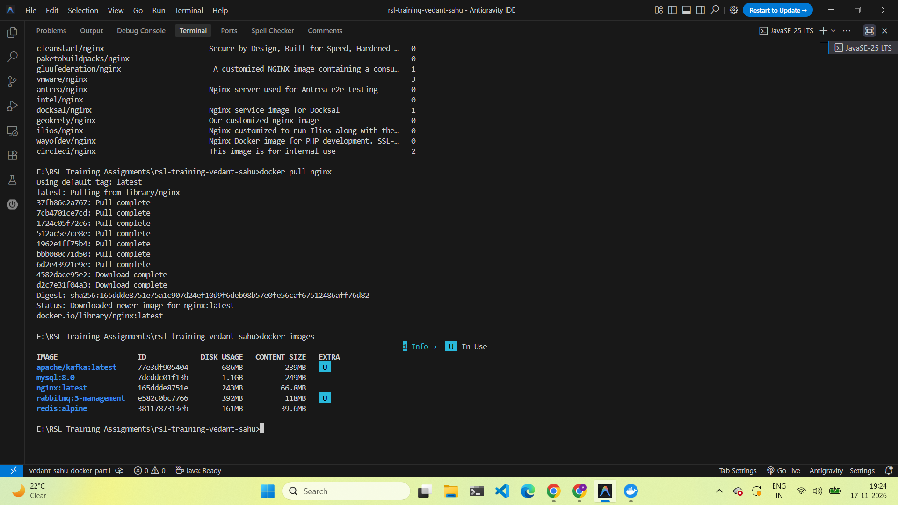
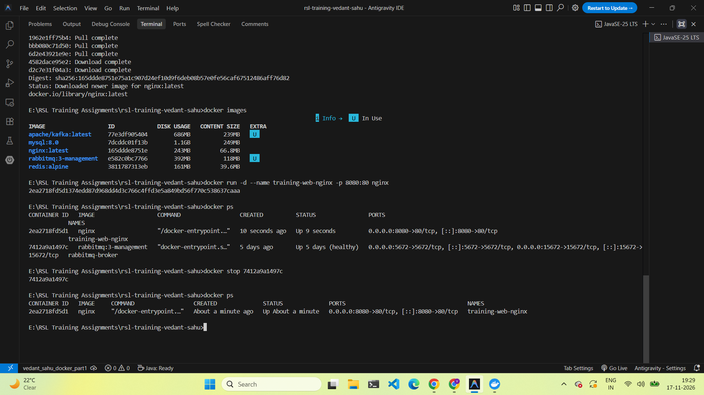
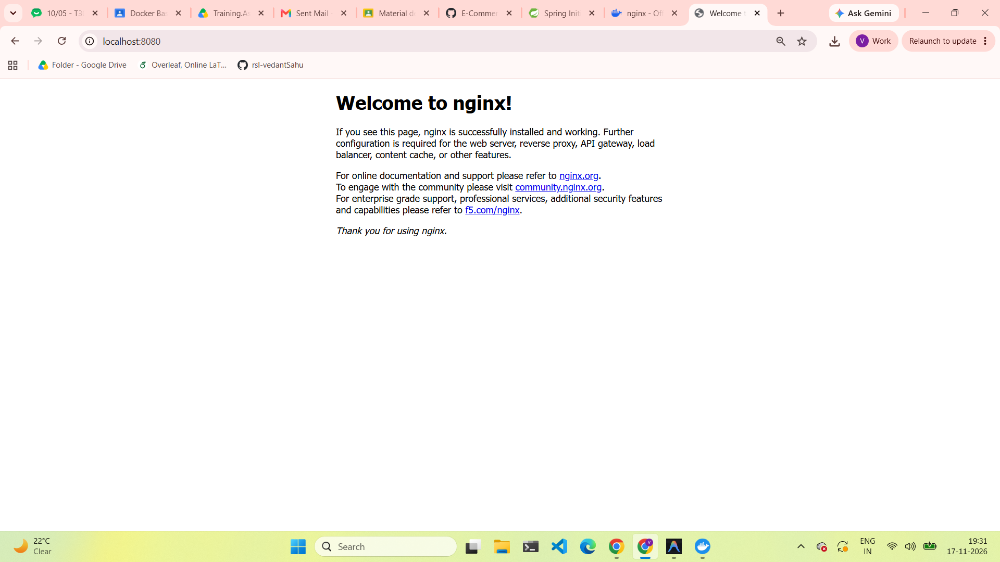
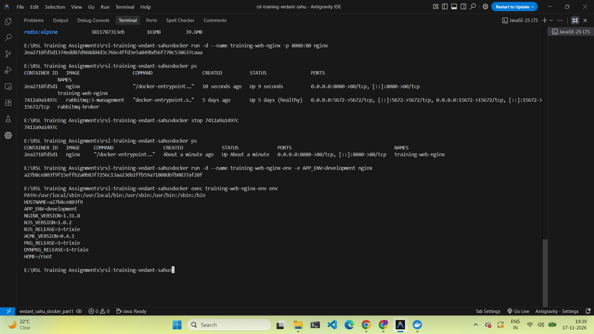
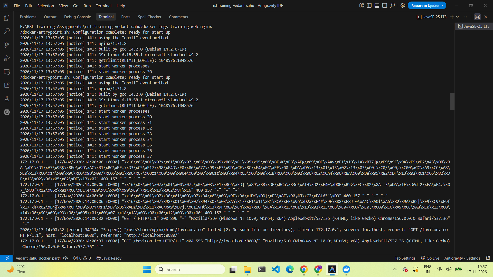
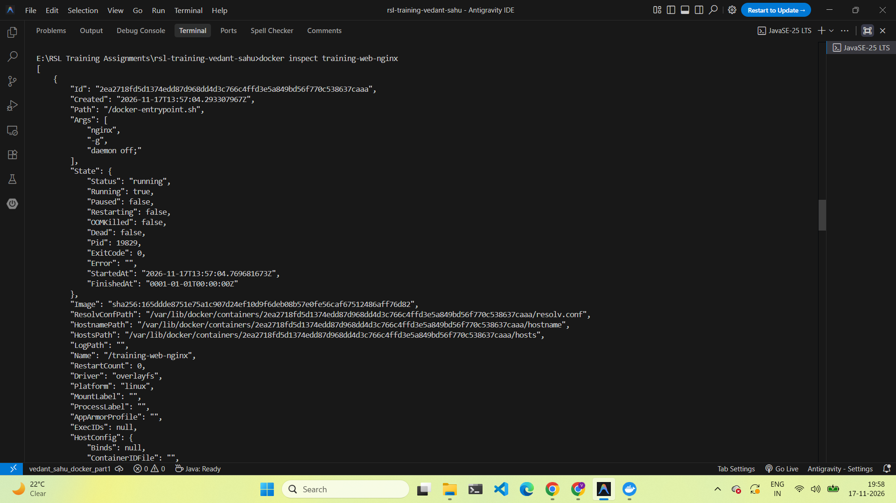
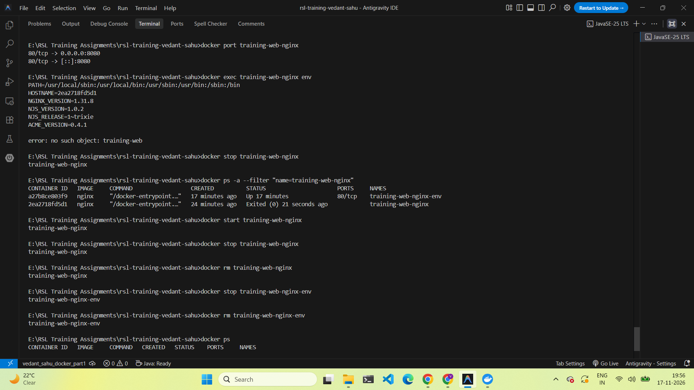

# Docker [Part 1] - Web Server Containerization & Lifecycle Management

## Overview
This repository contains the solution, documentation, commands, and visual proofs for **Docker [Part 1]**. The objective of this assignment is to run and manage an Nginx web server inside a Docker container rather than installing and configuring it directly on the host machine.

### Key Concepts Covered:
- **Docker Image Management**: Searching Docker Hub, pulling images, and verifying local image caches.
- **Port Mapping & Container Execution**: Running containers in detached mode (`-d`) and mapping host ports to container ports (`-p 8080:80`).
- **Runtime Configuration**: Injecting environment variables into containers at runtime (`-e`).
- **Container Exploration & Debugging**: Inspecting container metadata, analyzing live HTTP and daemon logs, and executing commands inside active containers (`docker exec`).
- **Container Lifecycle Management**: Observing and managing state transitions (**Running → Stopped → Started → Removed**).

---

## Deliverables Summary

### 1. Docker Commands Reference
| Operation | Command Used | Purpose |
| :--- | :--- | :--- |
| **Search Image** | `docker search nginx` | Search Docker Hub for the official Nginx image. |
| **Pull Image** | `docker pull nginx` | Download the official Nginx image locally. |
| **Verify Image** | `docker images` | List local Docker images and verify image size and ID. |
| **Run Container** | `docker run -d --name training-web-nginx -p 8080:80 nginx` | Run Nginx in detached mode mapped to host port 8080. |
| **Run Container with Env** | `docker run -d --name training-web-nginx-env -e APP_ENV=development nginx` | Pass `APP_ENV=development` runtime configuration. |
| **View Logs** | `docker logs training-web-nginx` | View daemon startup and incoming HTTP request logs. |
| **Inspect Container** | `docker inspect training-web-nginx` | View low-level system configuration in JSON format. |
| **Execute Command Inside** | `docker exec training-web-nginx env` | Run commands in an active container without restarting it. |
| **Check Port Mapping** | `docker port training-web-nginx` | List port mappings for the container. |
| **Check Container Status** | `docker ps` / `docker ps -a` | List running and all (including stopped) containers. |
| **Stop Container** | `docker stop training-web-nginx` | Gracefully shut down the running container. |
| **Start Container** | `docker start training-web-nginx` | Re-launch a previously stopped container. |
| **Remove Container** | `docker rm training-web-nginx` | Permanently delete the stopped container. |

---

### 2. Screenshots Directory
All validation screenshots are located in the [`screenshots/`](./screenshots/) directory:
1. [`Docker-nginx-image.png`](./screenshots/Docker-nginx-image.png) — Image search, download (`docker pull`), and local verification (`docker images`).
2. [`Docker-nginx-container-running.png`](./screenshots/Docker-nginx-container-running.png) — Running container in detached mode with port mapping (`docker ps`).
3. [`Docker-nginx-browser.png`](./screenshots/Docker-nginx-browser.png) — Accessing Nginx default page in browser at `http://localhost:8080`.
4. [`Docker-nginx-env.png`](./screenshots/Docker-nginx-env.png) — Running container with `APP_ENV=development` and verification via `docker exec`.
5. [`Docker-container-log.png`](./screenshots/Docker-container-log.png) — Live Nginx logs displaying startup events and HTTP requests.
6. [`Docker-container-inspect.png`](./screenshots/Docker-container-inspect.png) — Detailed container JSON metadata using `docker inspect`.
7. [`Docker-nginx-stop-removed.png`](./screenshots/Docker-nginx-stop-removed.png) — Container lifecycle transitions (Stop, Restart, Stop, Remove, and Empty verification).

---

## Detailed Task Walkthrough

### Task 1: Obtain the Docker Image

#### 1. Search for official Nginx image:
```powershell
docker search nginx
```
Identified the official Nginx repository on Docker Hub with `OFFICIAL: [OK]`.

#### 2. Pull the Nginx image to local machine:
```powershell
docker pull nginx
```
All image layers were pulled from `library/nginx` and verified against digest `sha256:165ddde8751e75a1c907d24ef10d9f6deb08b57e0fe56caf67512486aff76d82`.

#### 3. Verify local image:
```powershell
docker images
```
- **Repository**: `nginx`
- **Tag**: `latest`
- **Image ID**: `165ddde8751e`
- **Content Size**: `66.8MB`

#### Verification Screenshot:


---

### Task 2: Run the Web Server

#### 1. Create and run container:
```powershell
docker run -d --name training-web-nginx -p 8080:80 nginx
```
- `-d`: Detached mode (runs the container in the background).
- `--name training-web-nginx`: Assigns a descriptive, unique container name.
- `-p 8080:80`: Forwards port `8080` on host to port `80` (standard HTTP) inside the container.
- `nginx`: Base image used.

#### 2. Verify running status:
```powershell
docker ps
```
The container is listed with status `Up About a minute` and ports `0.0.0.0:8080->80/tcp, [::]:8080->80/tcp`.

#### Verification Screenshot:


#### 3. Access application from browser:
Opened `http://localhost:8080` in the browser. The default **"Welcome to nginx!"** landing page loaded successfully.

#### Verification Screenshot:


---

### Task 3: Configure the Container Using an Environment Variable

To demonstrate passing runtime configurations dynamically:

#### 1. Run container with environment variable:
```powershell
docker run -d --name training-web-nginx-env -e APP_ENV=development nginx
```
- `-e APP_ENV=development`: Injects the environment variable into the container environment.

#### 2. Verify environment variable inside the container:
```powershell
docker exec training-web-nginx-env env
```
Output verified that `APP_ENV=development` exists alongside the standard Nginx system environment variables:
```text
PATH=/usr/local/sbin:/usr/local/bin:/usr/sbin:/usr/bin:/sbin:/bin
HOSTNAME=a27b8ce803f9
APP_ENV=development
NGINX_VERSION=1.31.8
NJS_VERSION=1.0.2
NJS_RELEASE=1~trixie
ACME_VERSION=0.4.1
PKG_RELEASE=1~trixie
DYNPKG_RELEASE=1~trixie
HOME=/root
```

#### Verification Screenshot:


---

### Task 4: Explore the Running Container

#### 1. View logs:
```powershell
docker logs training-web-nginx
```
Displays daemon initialization, worker processes spawn, and incoming HTTP requests (GET `/`, status 200, user agent Chrome).

#### Verification Screenshot:


#### 2. Inspect container:
```powershell
docker inspect training-web-nginx
```
Provides the full JSON configuration including State, Config, Mounts, and NetworkSettings.

#### Verification Screenshot:


#### 3. Container Identification Summary:
Based on `docker inspect`, `docker port`, and `docker exec`:

| Parameter | Value Identified | Command Used |
| :--- | :--- | :--- |
| **Container ID** | `2ea2718fd5d1374edd87d968dd4d3c766c4ffd3e5a849bd56f770c538637caaa` (Short ID: `2ea2718fd5d1`) | `docker inspect --format '{{.Id}}' training-web-nginx` |
| **Image Used** | `nginx` (`sha256:165ddde8751e...`) | `docker inspect --format '{{.Config.Image}}' training-web-nginx` |
| **Port Mapping** | `80/tcp -> 0.0.0.0:8080`, `80/tcp -> [::]:8080` | `docker port training-web-nginx` |
| **Environment Variables** | `PATH=/usr/local/sbin:...`, `NGINX_VERSION=1.31.8`, `NJS_VERSION=1.0.2` | `docker exec training-web-nginx env` |
| **Container IP Address** | `172.17.0.x` (Docker bridge network) | `docker inspect --format '{{range .NetworkSettings.Networks}}{{.IPAddress}}{{end}}' training-web-nginx` |

---

### Task 5: Container Lifecycle Management

The assignment required observing the full lifecycle transition without immediate removal:
$$\text{Running} \longrightarrow \text{Stopped} \longrightarrow \text{Started} \longrightarrow \text{Removed}$$

#### 1. Stop the container:
```powershell
docker stop training-web-nginx
```

#### 2. Verify stopped state:
```powershell
docker ps -a --filter "name=training-web-nginx"
```
Container status updated to: `Exited (0) 21 seconds ago`.

#### 3. Start the container again:
```powershell
docker start training-web-nginx
```
Container transitioned back to the running state; web application was re-verified at `http://localhost:8080`.

#### 4. Stop and remove the containers:
```powershell
docker stop training-web-nginx
docker rm training-web-nginx

docker stop training-web-nginx-env
docker rm training-web-nginx-env
```

#### 5. Verify that containers no longer exist:
```powershell
docker ps
```
The active container list returned empty, verifying clean teardown and resource release.

#### Verification Screenshot:

