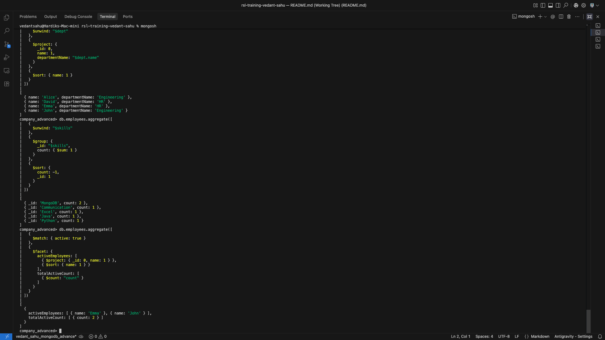
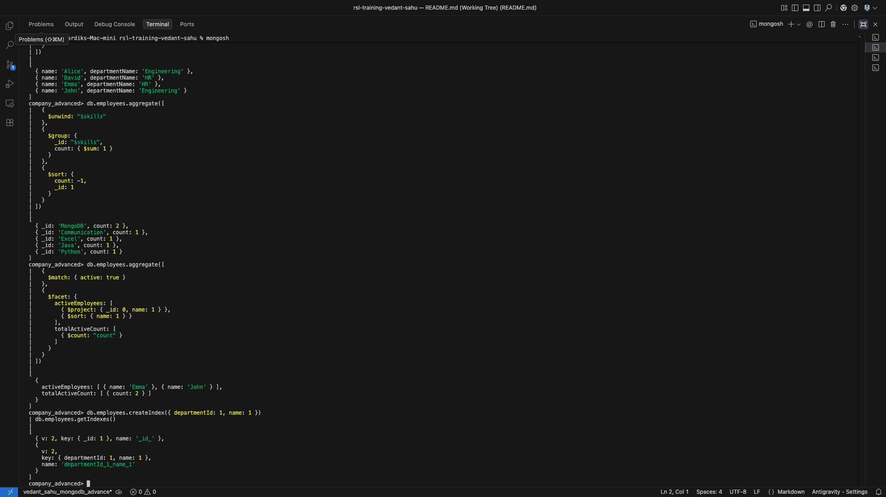
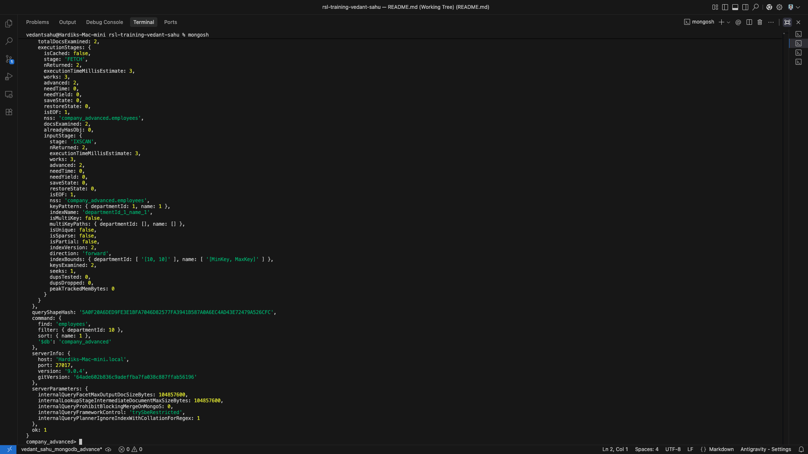
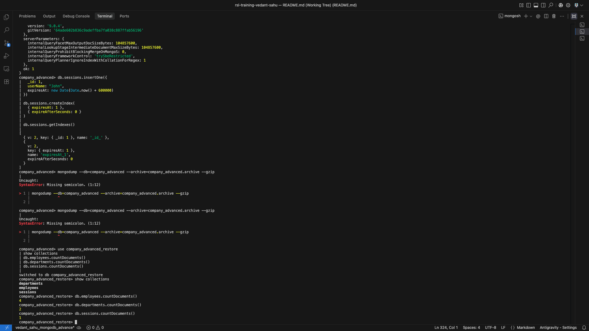

# MongoDB Advanced Assignment: Company Advanced Database

## Overview
This repository contains the MongoDB solution scripts, documentation, and query execution for the **MongoDB Advanced Assignment**. The implementation covers advanced database operations, performance optimization, and administration in MongoDB using `mongosh`:
- **Schema Validation** using `$jsonSchema`
- **Advanced Array Queries & Updates** (`$elemMatch`, positional `$`, `arrayFilters`)
- **Bulk Write Operations** (`bulkWrite()`)
- **Advanced Aggregation Framework** (`$lookup`, `$unwind`, `$facet`)
- **Indexing & Performance Analysis** (Compound Index, `explain("executionStats")`, TTL Index)
- **Database Backup & Restoration** (`mongodump` & `mongorestore` with gzip archives)
- **MongoDB Production & Architectural Concepts** (Replication, Sharding, Transactions, Change Streams, Security)

---

## Deliverables
- [`mongodb-advanced-assignment.js`](./mongodb-advanced-assignment.js) - Complete MongoDB scripts and commands for Tasks 1–5.
- [`backup-restore-commands.txt`](./backup-restore-commands.txt) - Command-line backup and restore commands for Task 6.
- [`answers.md`](./answers.md) - Recorded `explain("executionStats")` metrics (Task 5.2) and answers to the 12 MCQs (Task 7).
- `screenshots/` - Visual evidence of schema validation, updates, aggregations, indexes, explain plan, and restore counts.

---

## Task Details & Solution Queries

### Task 1: Schema Validation and Data Creation

#### 1. Database Selection
```javascript
use company_advanced;
```

#### 2. Create Validated Collection with `$jsonSchema`
```javascript
db.createCollection("employees", {
  validator: {
    $jsonSchema: {
      bsonType: "object",
      required: ["name", "departmentId", "experience", "active"],
      properties: {
        name: {
          bsonType: "string",
          description: "must be a string and is required"
        },
        departmentId: {
          bsonType: "int",
          description: "must be an integer and is required"
        },
        experience: {
          bsonType: "int",
          description: "must be an integer and is required"
        },
        active: {
          bsonType: "bool",
          description: "must be a boolean and is required"
        }
      }
    }
  }
});
```

#### 3. Insert Starting Dataset (3 Documents)
```javascript
db.employees.insertMany([
  {
    _id: 1,
    name: "John",
    departmentId: 10,
    skills: ["Java", "MongoDB"],
    experience: 4,
    active: true,
    certifications: [
      { name: "MongoDB", status: "Expired", expiryYear: 2026 }
    ]
  },
  {
    _id: 2,
    name: "Alice",
    departmentId: 10,
    skills: ["Python", "MongoDB"],
    experience: 6,
    active: true,
    certifications: [
      { name: "MongoDB", status: "Active", expiryYear: 2028 }
    ]
  },
  {
    _id: 3,
    name: "David",
    departmentId: 20,
    skills: ["Communication"],
    experience: 3,
    active: false,
    certifications: [
      { name: "Communication", status: "Active", expiryYear: 2027 }
    ]
  }
]);
```

#### 4. Test Schema Validation Rule
Inserting an invalid document is rejected by MongoDB with `Document failed validation`:
```javascript
db.employees.insertOne({
  _id: 99,
  name: 123,
  departmentId: "HR",
  experience: "one",
  active: "yes"
});
```

---

### Task 2: Advanced Array Queries and Updates

#### 2.1 Find Matching Array Object (`$elemMatch`)
```javascript
db.employees.find({
  certifications: {
    $elemMatch: {
      name: "MongoDB",
      status: "Active"
    }
  }
});
```

#### 2.2 Update Array Element with Positional Operator (`$`)
```javascript
db.employees.updateOne(
  { name: "John", "certifications.name": "MongoDB" },
  { $set: { "certifications.$.status": "Active" } }
);
```

#### 2.3 Update Selected Elements with `arrayFilters`
```javascript
db.employees.updateMany(
  {},
  { $set: { "certifications.$[elem].status": "Renewal Due" } },
  { arrayFilters: [{ "elem.expiryYear": { $lt: 2027 } }] }
);
```

---

### Task 3: Bulk Write Operations

Executing multiple operations in a single round-trip:
```javascript
db.employees.bulkWrite([
  {
    updateOne: {
      filter: { name: "John" },
      update: { $inc: { experience: 1 } }
    }
  },
  {
    updateOne: {
      filter: { name: "Alice" },
      update: { $set: { active: false } }
    }
  },
  {
    insertOne: {
      document: {
        _id: 4,
        name: "Emma",
        departmentId: 20,
        skills: ["Excel"],
        experience: 2,
        active: true,
        certifications: [
          { name: "Excel", status: "Active", expiryYear: 2026 }
        ]
      }
    }
  }
]);
```

---

### Task 4: Advanced Aggregation

#### 4.1 Join Employees with Departments (`$lookup` & `$unwind`)
```javascript
db.employees.aggregate([
  {
    $lookup: {
      from: "departments",
      localField: "departmentId",
      foreignField: "_id",
      as: "dept"
    }
  },
  {
    $unwind: "$dept"
  },
  {
    $project: {
      _id: 0,
      name: 1,
      departmentName: "$dept.name"
    }
  },
  {
    $sort: { name: 1 }
  }
]);
```

#### 4.2 Count Employees for Each Skill (`$unwind` & `$group`)
```javascript
db.employees.aggregate([
  {
    $unwind: "$skills"
  },
  {
    $group: {
      _id: "$skills",
      count: { $sum: 1 }
    }
  },
  {
    $sort: {
      count: -1,
      _id: 1
    }
  }
]);
```

#### 4.3 Active Employees and Total Count (`$facet`)
```javascript
db.employees.aggregate([
  {
    $match: { active: true }
  },
  {
    $facet: {
      activeEmployees: [
        { $project: { _id: 0, name: 1 } },
        { $sort: { name: 1 } }
      ],
      totalActiveCount: [
        { $count: "count" }
      ]
    }
  }
]);
```

---

### Task 5: Indexing and Query Performance

#### 5.1 Compound Index
```javascript
db.employees.createIndex({ departmentId: 1, name: 1 });
db.employees.getIndexes();
```

#### 5.2 Query Performance Analysis (`explain("executionStats")`)
```javascript
db.employees
  .find({ departmentId: 10 })
  .sort({ name: 1 })
  .explain("executionStats");
```
- **winning plan stage**: `IXSCAN` (with `FETCH`)
- **nReturned**: `2`
- **totalDocsExamined**: `2`
- **totalKeysExamined**: `2`

#### 5.3 TTL (Time-To-Live) Index
```javascript
db.sessions.insertOne({
  _id: 1,
  userName: "John",
  expiresAt: new Date(Date.now() + 600000)
});

db.sessions.createIndex(
  { expiresAt: 1 },
  { expireAfterSeconds: 0 }
);
```

---

### Task 6: Backup and Restore

```bash
# Backup company_advanced database to compressed archive
mongodump --db=company_advanced --archive=company_advanced.archive --gzip

# Restore archive to company_advanced_restore database
mongorestore --nsInclude="company_advanced.*" --nsFrom="company_advanced.*" --nsTo="company_advanced_restore.*" --archive=company_advanced.archive --gzip
```

**Restored Collection Counts Verification:**
- `employees`: 4
- `departments`: 2
- `sessions`: 1

---

### Task 7: MCQs
See complete answers and detailed explanations in [`answers.md`](./answers.md):
- **Q1**: B
- **Q2**: B
- **Q3**: C
- **Q4**: A
- **Q5**: C
- **Q6**: B
- **Q7**: C
- **Q8**: B
- **Q9**: C
- **Q10**: B
- **Q11**: A
- **Q12**: C

---

## Execution Screenshots

### 1. Schema Validation
Validation rule rejection of invalid document and valid count verification (`count = 3`):


### 2. Array Updates & Bulk Write
Final certification states and verification of the 3 bulk write operations:


### 3. Aggregation Pipelines
Outputs for `$lookup` join, `$unwind` skill counts, and `$facet` active employee summary:


### 4. Index Verification
Verifying compound index `departmentId_1_name_1` and TTL index `expiresAt_1`:


### 5. Execution Performance Analysis
`explain("executionStats")` showing `IXSCAN` winning plan and metrics:


### 6. Restored Database & Collection Counts
Verification of `company_advanced_restore` collections and document counts (4, 2, 1):


